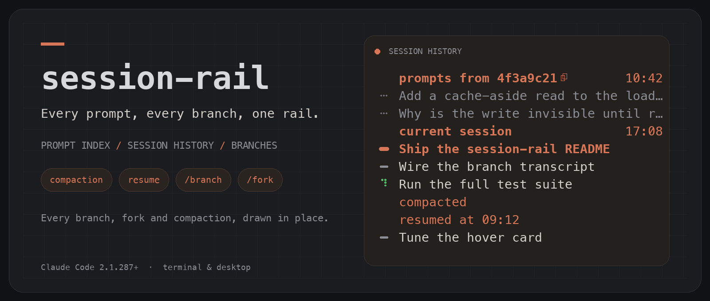
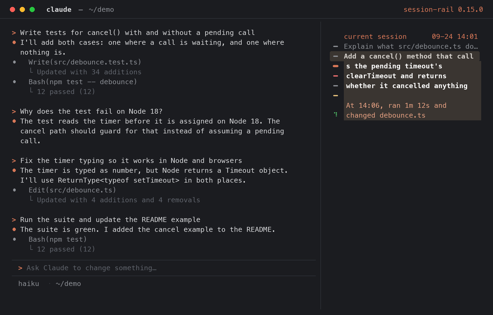
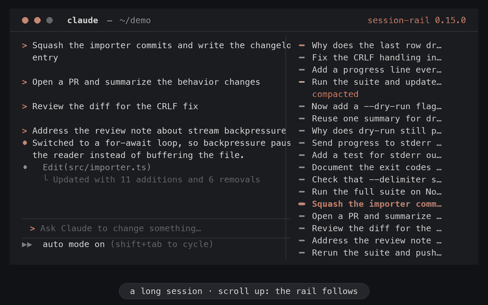
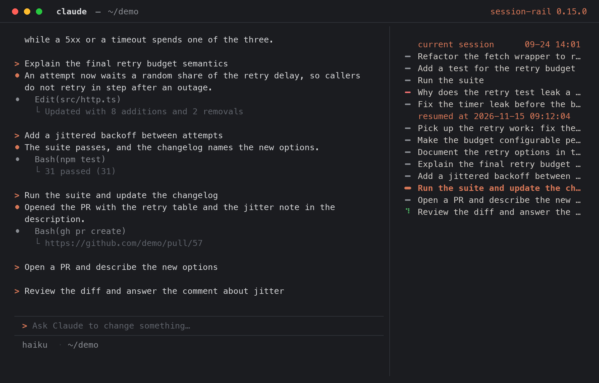
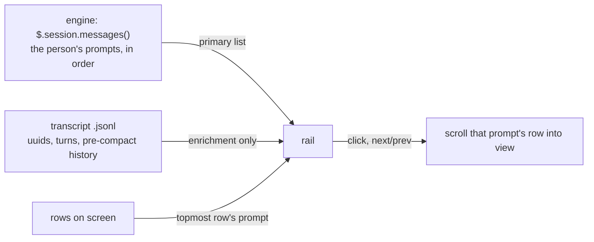

<div align="center">



A rail of your prompts for Claude Code. Hover to read one, click to jump back to it.

**English** · [简体中文](README.zh-CN.md)


</div>

## Highlights

- **A map of the session.** One tick per prompt, in a pane beside the transcript or a row of bars above or below the prompt input; the prompt you are reading is marked.
- **Read a prompt whole.** Hover a cut row for its full text, when it was sent, how long its turn took, how it ended and the files it edited.
- **Jump back in one click.** Click any row or bar, or step with `next`/`prev`, a prompt number or a word search.
- **Long sessions hold together.** A `/compact` divider, the prompts restored from before it, and the seams of a `/resume`, a fork or a context overflow.
- **Yours to tune.** Dark and light palettes, eleven card families, and keybindings for stepping.
- **Local only.** No network requests and no analytics; the [privacy policy](plugins/session-rail/README.md#privacy) lists every file it reads and every value it stores.

## Quick start

**Requires Claude Code 2.1.287 or later**, in the terminal or in the Code tab of the Claude desktop app. Mods are on by default there. If you set `CLAUDE_CODE_ENABLE_FUNCTION_HOOKS` during early access, you can remove it, since Claude Code now ignores it.

1. Install from the marketplace, inside a session:

   ```text
   /plugin marketplace add hfwang0318/session-rail
   /plugin install session-rail@hfwang
   ```

   Or from your shell, with a checkout of this repository:

   ```bash
   claude plugin marketplace add /path/to/session-rail
   claude plugin install session-rail@hfwang
   ```

   For development, load the plugin straight from the checkout instead:

   ```bash
   claude --plugin-dir /path/to/session-rail/plugins/session-rail
   ```

2. Start a new session. The rail opens on its own.

> [!TIP]
> Mouse works best with `"tui": "fullscreen"`.

## Three layouts

### Vertical, beside the transcript (default)



`/session-rail vertical`. One row per prompt, beside the transcript. The bold row is the prompt you are reading.

### Horizontal, above the prompt


`/session-rail horizontal`. A row of bars over the prompt input.

### Below, under the hint line


`/session-rail below`. Bars beside the status line, under the prompt input.


## Hover to read, click to jump


- **Hover** a cut prompt: the whole text, when it was sent, how long its turn took, how it ended, and the files it edited.
- **Click** any row or bar: the transcript jumps to it, and the row flashes.
- A running turn spins its tick. A prompt Claude Code refuses to scroll to turns dotted, and `next`/`prev` skip it.


<details>
<summary>Hover card details</summary>

A prompt too long for the card's room opens on the roomier side as a window with a scrollbar on its right edge; its stats stay pinned at the card's foot. A card that opens above its row carries the whole prompt from the first line and blanks the row while hovered. The wheel over the card or its row scrolls the card, not the rail. The `/config` rows "Expand on hover", "Scroll on hover" (one-line marquee instead of expanding), "Hover card background", "Hover card text" and "Hover card stats text" adjust it. The card is drawn in every layout; a custom panel that cannot carry the bright prompt highlight falls back to whichever white or black it can.

</details>

## Long sessions


Twenty prompts or two hundred, the rail stays a map of the session:

- A `/compact` gets a `compacted` divider, and the prompts before it are restored from the transcript, so the list does not shrink to the engine's window.
- Scrolling back through the transcript moves the bold row; when the list is taller than the pane, its window follows.
- Jump by number (`/session-rail 12`), by words (`/session-rail find migration`), or with `next`/`prev`.



## Resume, continue, fork

One conversation can outlive its process. The rail draws the seams.

### Resumed



`/resume` draws a `resumed at …` line over the first prompt of the new run. The head keeps the conversation's original start, not the moment it was resumed, and reads `current session` like every block heading.

### Forked or continued


A fork (`claude --resume <id> --fork-session`) or a context overflow starts a new session from an old one. The rail shows both as one conversation, with the earlier session as its own block:

- `prompts from <id> ⧉` heads the earlier session, dated at the pane's right edge. Its rows are dotted: no jump reaches them, and a press says why. Press the heading to copy the full id.
- `current session` heads this session's own part.
- `[ click to load parent … ]` loads one earlier session per press, up to four back. Nothing is read until you ask.


## Colors and themes


Two palettes, dark and light, picked by "Color scheme" (`auto` follows your `/config` theme). Eleven card families, each with a dark and a light side. `/session-rail-preview` shows them in the scheme you are using.


<details>
<summary>All eleven families, with their colors</summary>

| Card theme | dark | light | accent (dark / light) |
| --- | --- | --- | --- |
| `warm-taupe` (default) | `#3A3531` | `#E8E1D8` | `#D77757` / `#9E4422` |
| `warm-charcoal` | `#332F2C` | `#E5DED6` | `#D77757` / `#9E4422` |
| `sienna` | `#3A2D28` | `#EBDDD4` | `#D77757` / `#9E4422` |
| `mauve` | `#342E31` | `#E5DDE0` | `#D8A8C4` / `#7A3A62` |
| `teal` | `#1E3438` | `#D8E8E5` | `#5CC8CC` / `#0E6A70` |
| `indigo` | `#282F45` | `#DEE3F4` | `#93A2E8` / `#3A4FA3` |
| `burgundy` | `#3A2227` | `#F1DEE3` | `#D77757` / `#9E4422` |
| `olive` | `#2F321F` | `#E5E7D3` | `#D77757` / `#9E4422` |
| `plum` | `#34243C` | `#EBE0F3` | `#C08ADB` / `#6E3F9E` |
| `ochre` | `#3A3018` | `#F3E8D0` | `#D77757` / `#9E4422` |
| `slate` | `#2A2E33` | `#DEE2E6` | `#9DB4D6` / `#3F5A7A` |

"Accent follows card theme" (on by default) lets `mauve`, `teal`, `indigo`, `plum` and `slate` tint the accent too; the warm families keep Claude's orange so the accent stays distinct from the green, yellow and red status colors. Every pair clears the body-text contrast floor on its own side.

</details>

## Commands

| Command | What it does |
| --- | --- |
| `/session-rail horizontal` | Bars above the prompt input |
| `/session-rail vertical` | A pane beside the transcript |
| `/session-rail below` | Bars under the hint line below the prompt input |
| `/session-rail off` | Hide the rail |
| `/session-rail next` | Jump to the next prompt |
| `/session-rail prev` | Jump to the previous prompt |
| `/session-rail first`, `last` | Jump to the first or the newest prompt |
| `/session-rail 12`, `#12` | Jump to prompt #12 |
| `/session-rail find <words>` | Jump to the newest prompt that holds the words |
| `/session-rail preview` (`preview theme`) | Open a preview pane with every card theme sampled in the current color scheme |
| `/session-rail-next`, `/session-rail-prev` | Jump to the next or previous prompt, with no argument, for a keybinding |
| `/session-rail-toggle` | Hide the rail, or bring it back in the layout last on, with no argument, for a keybinding |
| `/session-rail-preview` | Open the theme preview pane, for every card theme or the one named, as `/session-rail-preview sienna` |
| `/session-rail` | Reopen the rail in the current layout |

The layout is also "Rail mode" in `/config`. The theme rows there are "Color scheme", "Card theme", "Accent follows card theme", "Expand on hover", "Scroll on hover", "Hover card background", "Hover card text" and "Hover card stats text". "Classic hooks" keeps `classic.SessionStart` and `classic.Stop` registered (on by default); turn it off only where managed settings pass them over, since the rail then finds the transcript under `CLAUDE_CONFIG_DIR` or `~/.claude`.

<details>
<summary>Config rows in detail</summary>

The "Color scheme" row picks the rail's palette: `auto` (the default) follows the `/config` theme — a built-in name says whether it is light or dark, and a custom theme is read from its definition's `base` — and switches as soon as the theme does, without a restart; `dark` or `light` fixes one. "Card theme" picks the color family of the hover card and the row or bar under the pointer; each family carries a dark and a light panel, and "Color scheme" draws the matching side. "Accent follows card theme" decides whether the accent — the prompt being read, the `compacted` divider, the `current session` and `prompts from <id> ⧉` headings, the `resumed at …` line, the card's stats line and the marquee seam — takes the family's own accent or stays Claude's orange. The "Expand on hover" row turns the cards on or off; "Scroll on hover" scrolls a cut prompt on one line instead. "Hover card background" and "Hover card text" take a theme key or a raw color; empty follows the family's variant for the active scheme. A custom panel the bright highlight cannot sit on falls back to whichever white or black it can carry.

</details>

### Keyboard

Bind the step commands in `~/.claude/keybindings.json`; they run mid-turn too:

```json
{
  "bindings": [
    { "context": "Chat", "bindings": { "ctrl+k": "command:session-rail-prev", "meta+j": "command:session-rail-next" } }
  ]
}
```

In the horizontal layout, `ctrl+x tab` moves the focus to the bars: `←` `→` move across them, `Enter` jumps, `Esc` returns to the prompt input.

## Tick and color legend

| Tick | Meaning |
| --- | --- |
| `━` `┃` | The prompt you are reading |
| `─` `│` | Any other prompt |
| `┄` `┆` | A prompt Claude Code refused to scroll to; `next` and `prev` skip it |
| `⌁` / `compacted` | The prompt that opens the segment after a `/compact` |
| `⇡` | The first prompt of an earlier session's block, in the band and below |
| `⠋` `⠙` `⠹` … | Its turn is running; the tick spins in place |

| Color | Meaning |
| --- | --- |
| accent | The prompt you are reading, the `compacted` divider, the `current session` and `prompts from <id> ⧉` headings, and the `resumed at …` line |
| card highlight | A hover card's prompt and the row or bar under the pointer: white in dark themes, black in light ones |
| body text | The rail's rows, labels and a card's chrome |
| card panel | The hover card and the selected row, from the "Card theme" family |
| green | Its turn is running |
| yellow | The turn was interrupted |
| red | The turn ended with an API error |
| gray | Claude Code refused to scroll to it |

## How it works



The engine's message list is the rail's primary source. It names the person's prompts in conversation order without reading a file, so the list survives a transcript that is missing, renamed, still being written, or read too late after a `/clear`. The transcript is read as an optional second source: it supplies the uuid each prompt is stored under (so a jump can address its row), each prompt's turn details, and prompts older than the engine's 4096-entry window. A transcript read can add to the engine's list but never empty it.

<details>
<summary>Compaction, continuations, branches and jumps</summary>

A compaction replaces the engine's list with a summary message plus the most recent rows, so the rail filters that summary out and restores the prompts before the boundary from the transcript. Prompts abandoned with `/rewind` still drop out: the transcript read follows only the live branch.

A session continued into another — by `/resume`, by a fork such as `claude --resume <id> --fork-session`, or by a context overflow Claude Code carried forward — opens its transcript with a summary row that names the session it continued. The rail reads that transcript from the same folder, puts its prompts before this session's, and drops the rows the continuation copied. Reading is on demand: a `[ click to load more prompts from parent session <id> ]` primary button sits above the oldest prompt and reads one session per press, returning while a further session waits (up to four back). Those prompts' rows live in the other transcript, so they draw with the dotted tick and `next`/`prev` skip them; pressing one says why instead of leaving a failed scroll. The block is headed `prompts from <id> ⧉` — a press copies the full id, the one `/resume` takes — and this session's own part is headed `current session`; each heading carries its session's start time (`11-15 17:10`) flush with the pane's right edge, so the blocks' times line up and every session is dated at its first prompt. The band and the below line have no row to head, so a `⇡` on the first prompt of each block stands in.

A `/branch` started inside a session is drawn as one conversation too, but from a different signal: the command copies the conversation's rows into the branch's own transcript and stamps each with the session it came from, so a change of that session id heads a block `prompts from <id> ⧉`. Those rows are in this transcript, not another file — they keep the jumpable tick, `next`/`prev` do not skip them, and no load button is offered. The line at its start reads `current session`, dated at the pane's right edge — the same label a continued session's own block gets — where a `/resume`'s reads `resumed at …`.

A `/fork` starts a new session on a copy of the running one. The prompts it copied are headed `prompts from <id> ⧉` too, and the fork point reads `current session`. The copies carry no `/branch` stamp: the session id the rows were originally written under, together with the moment the fork note says the two sessions shared history to, tells them from the rows written since.

A jump addresses the uuid the transcript stores for a prompt. Where no transcript can be read, the rail records the request id the prompt's row was drawn under, and matches a prompt restored without one to the engine's list by its text, so a click still lands. The transcript is found by the classic hooks where they run, and otherwise by session id under `CLAUDE_CONFIG_DIR` or `~/.claude`.

The prompt you are reading owns the topmost row on screen. The transcript is read again only when its size or time changed.

</details>

## Limitations

<details>
<summary>Known limits</summary>

- The mods API may still change between Claude Code releases.
- The hover card is drawn in every layout; in the vertical layout its prompt wraps to the pane's width.
- The below rail is the terminal's. The Claude desktop app draws it above the prompt, as the horizontal rail.
- The Claude desktop app draws the horizontal rail and its hover cards, but a click cannot jump there. The app gives a plugin no way to scroll its transcript, so the rail says so once a session. The prompt being read is named beside the bars rather than on the line above them, since the app paints a card over that line without hiding what is under it. Checked with Claude Code 2.1.280, the app did not draw the vertical pane.
- The dock width is shared by all plugin panes; drag its edge to narrow it, down to 24 columns.
- A `/compact` command's own row cannot be jumped to; its tick turns dotted after the first try.
- The `click to load more prompts from parent session` row is drawn by the pane, so an earlier session is offered in the vertical layout. The band and the below line mark each block start with `⇡` once the pane has loaded a level, but cannot ask for one themselves.
- Near the end of the transcript, `next` cannot scroll further.
- After a compaction, the engine keeps only the summary and the most recent messages. Prompts before the boundary are listed from the transcript; where no transcript can be read at all, they cannot be listed in that session.
- With no transcript to read, a prompt can be jumped to only after its row has been drawn once, since the engine's list carries no row id of its own.
- A `/resume` the module is never told of — a new process launched with the classic hooks passed over — adds no line for that moment, and with no readable transcript the pane's head names the moment the module loaded rather than the conversation's original start. An in-process `/resume` is told of through `session.end`, so it draws its line. The moments a conversation was resumed at, and which of them began with a `/branch`, are kept in the mod's store for the 20 most recent sessions and in the engine's session state, so a hot reload and a new process keep its lines; the hash-keyed prompt counts live only in the session state, so a new process places the latest line by the transcript's timestamps. Up to 256 moments and 256 distinct prompt texts are kept.

</details>

## Privacy

session-rail makes no network requests. It reads the session's own message list, the transcript file, and — with "Color scheme" set to `auto` — your `/config` theme, and it keeps its layout and the moments a session was resumed in its own store. The full policy, listing every file read, every program run and every value written, is the [Privacy section of the plugin README](plugins/session-rail/README.md#privacy).

## Development

```bash
claude --plugin-dir plugins/session-rail        # load this checkout; saving reloads it
claude plugin validate plugins/session-rail
claude plugin test plugins/session-rail
```

Run `/plugin-types .claude/types` in a session here for type declarations. Bump the version in `plugins/session-rail/.claude-plugin/plugin.json` with each release, since installed copies update only when it changes. Bugs and ideas go to the [issue tracker](https://github.com/hfwang0318/session-rail/issues); the architecture notes for the hooks module are in [CLAUDE.md](CLAUDE.md).

The pictures in this README are drawn by `docs/make-assets.py` (Pillow), not captured from a terminal, so they can be regenerated after a UI change:

```bash
python3 docs/make-assets.py
```

The Claude directory listing tracks the `release` branch rather than `main`, so merged changes reach it only when a release is pushed there. After a Release PR merges, publish it with:

```bash
git push origin main:release
```

The directory picks the new commit up within about six hours and scans it before it goes live.

## Source and license

Source: [hfwang0318/session-rail](https://github.com/hfwang0318/session-rail). Released under the [MIT license](LICENSE).
