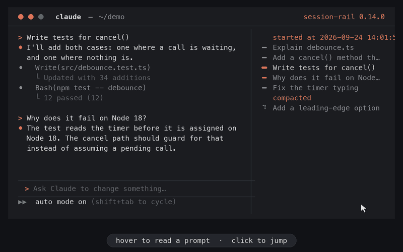
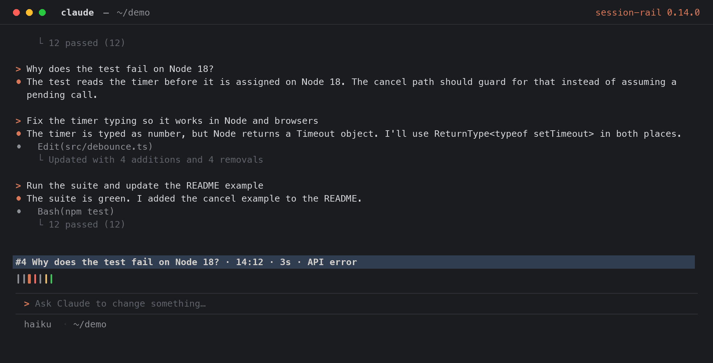
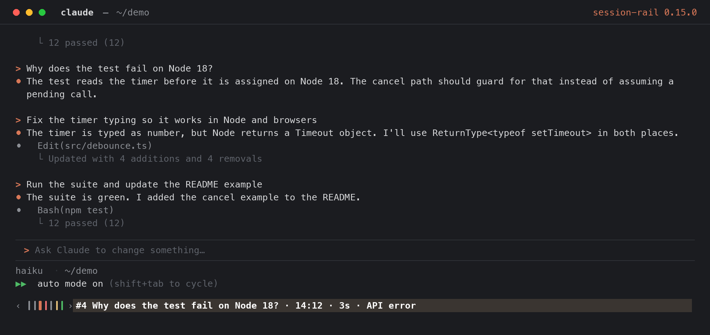
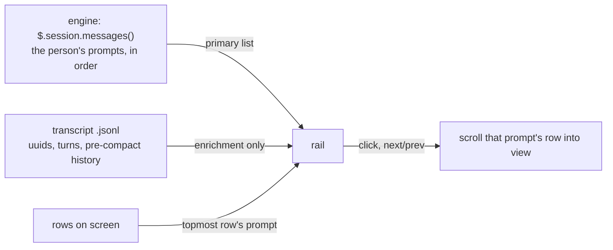

<div align="center">

# session-rail

A rail of your prompts for Claude Code. Hover to read one, click to jump back to it.




</div>

> **Fork.** session-rail is a fork of [prompt-rail](https://github.com/oikon48/prompt-rail) by oikon48, under the MIT license. The rail, layouts, commands and settings are prompt-rail's. The history source is rebuilt: the engine's own message list (`$.session.messages()`) now leads, and the transcript file enriches it with ids, turn details and history older than the engine keeps. See [docs/refactor-comparison.md](docs/refactor-comparison.md) for what changed and why.

## Quick start

session-rail is a mod, so it needs Claude Code 2.1.287 or later, where mods are on by default. If you set `CLAUDE_CODE_ENABLE_FUNCTION_HOOKS` during early access, you can remove it, since Claude Code now ignores it.

1. Install from the marketplace, inside a session:

   ```
   /plugin marketplace add hfwang0318/session-rail
   /plugin install session-rail@hfwang
   ```

   Or from your shell, with a checkout of this repository:

   ```bash
   claude plugin marketplace add /path/to/session-rail
   claude plugin install session-rail@hfwang
   ```

   For development, load the plugin straight from the checkout instead:

   ```bash
   claude --plugin-dir /path/to/session-rail/plugins/session-rail
   ```

2. Start a new session. The rail opens on its own.

Mouse works best with `"tui": "fullscreen"`.

## Three layouts

### Horizontal, above the prompt



### Vertical, beside the transcript (default)


### Below, under the prompt

The bars sit on a row of their own under the hint line below the prompt input, next to the status line, with the prompt being read beside them. `‹` and `›` step to the previous or next prompt. The hint line above them is Claude Code's own, so its mode label and hints stay as they are.



<details>
<summary>The below layout in motion</summary>


</details>

## Hover cards

Hovering a prompt opens its card. A prompt too long for its row or bar is shown whole there, wrapped; a prompt the row already holds whole is not repeated, so the card carries only its stats. Under the prompt, the card names when it was sent — the clock time for today, the date and time for an older prompt — then how long its turn took, how it ended, and the files it edited. The "Expand on hover" row in `/config` turns the cards off, on by default.

## Commands

| Command | |
| --- | --- |
| `/session-rail horizontal` | Bars above the prompt input |
| `/session-rail vertical` | A pane beside the transcript |
| `/session-rail below` | Bars under the hint line below the prompt input |
| `/session-rail off` | Hide the rail |
| `/session-rail next` | Jump to the next prompt |
| `/session-rail prev` | Jump to the previous prompt |
| `/session-rail first`, `last` | Jump to the first or the newest prompt |
| `/session-rail 12`, `#12` | Jump to prompt #12 |
| `/session-rail find <words>` | Jump to the newest prompt that holds the words |
| `/session-rail-next`, `/session-rail-prev` | Jump to the next or previous prompt, with no argument, for a keybinding |
| `/session-rail-toggle` | Hide the rail, or bring it back in the layout last on, with no argument, for a keybinding |
| `/session-rail` | Reopen the rail in the current layout |

The layout is also the "Rail mode" row in `/config`, and it is kept across sessions. Switching it with `/session-rail <layout>` also draws where the rail now sits around the prompt input. The "Expand on hover" row turns the hover cards on or off; they are on by default.

### Keyboard

Bind the step commands in `~/.claude/keybindings.json`; they run mid-turn too:

```json
{
  "bindings": [
    { "context": "Chat", "bindings": { "ctrl+k": "command:session-rail-prev", "meta+j": "command:session-rail-next" } }
  ]
}
```

In the horizontal layout, `ctrl+x tab` moves the focus to the bars: the ring starts on the prompt you are reading, `←` `→` move it across the bars on screen and show its prompt, `Enter` jumps there, `Esc` returns to the prompt input.

## Tick legend

| Tick | Meaning |
| --- | --- |
| `━` `┃` | The prompt you are reading |
| `─` `│` | Any other prompt |
| `┄` `┆` | A prompt Claude Code refused to scroll to; `next` and `prev` skip it |
| `⌁` / `─ compacted ─` | The prompt that opens the segment after a `/compact` |

| Color | Meaning |
| --- | --- |
| accent | The prompt you are reading, and the `─ compacted ─` divider the rail draws itself |
| green | Its turn is running |
| yellow | The turn was interrupted |
| red | The turn ended with an API error |
| gray | Claude Code refused to scroll to it |

Colors are theme keys, so they follow the person's theme; a hover card still names the turn's outcome in words.

## How it works

<details>
<summary>From the engine's message list and the transcript to the rail</summary>



The engine's message list is the rail's primary source. It names the person's prompts in conversation order without reading a file, so the list survives a transcript that is missing, renamed, still being written, or read too late after a `/clear`. The transcript is read as an optional second source: it supplies the uuid each prompt is stored under (so a jump can address its row), each prompt's turn details, and prompts older than the engine's 4096-entry window. A transcript read can add to the engine's list but never empty it.

A compaction replaces the engine's list with a summary message plus the most recent rows, so the rail filters that summary out and restores the prompts before the boundary from the transcript. Prompts abandoned with `/rewind` still drop out: the transcript read follows only the live branch.

A jump addresses the uuid the transcript stores for a prompt. Where no transcript can be read, the rail records the request id the prompt's row was drawn under, and matches a prompt restored without one to the engine's list by its text, so a click still lands. The transcript is found by the classic hooks where they run, and otherwise by session id under `CLAUDE_CONFIG_DIR` or `~/.claude`.

The prompt you are reading owns the topmost row on screen. The transcript is read again only when its size or time changed.

</details>

## Limitations

<details>
<summary>Known limits</summary>

- The mods API may still change between Claude Code releases.
- The hover card is drawn in every layout; in the vertical layout its prompt wraps to the pane's width.
- The below rail is the terminal's. The Claude desktop app draws it above the prompt, as the horizontal rail.
- The Claude desktop app draws the horizontal rail and its hover cards, but a click cannot jump there. The app gives a plugin no way to scroll its transcript, so the rail says so once a session. The prompt being read is named beside the bars rather than on the line above them, since the app paints a card over that line without hiding what is under it. Checked with Claude Code 2.1.280, the app did not draw the vertical pane.
- The dock width is shared by all plugin panes; drag its edge to narrow it, down to 24 columns.
- A `/compact` command's own row cannot be jumped to; its tick turns dotted after the first try.
- Near the end of the transcript, `next` cannot scroll further.
- After a compaction, the engine keeps only the summary and the most recent messages. Prompts before the boundary are listed from the transcript; where no transcript can be read at all, they cannot be listed in that session.
- With no transcript to read, a prompt can be jumped to only after its row has been drawn once, since the engine's list carries no row id of its own.

</details>

## Development

```bash
claude --plugin-dir plugins/session-rail        # load this checkout; saving reloads it
claude plugin validate plugins/session-rail
claude plugin test plugins/session-rail
```

Run `/plugin-types .claude/types` in a session here for type declarations. Bump the version in `plugins/session-rail/.claude-plugin/plugin.json` with each release, since installed copies update only when it changes.

The Claude directory listing tracks the `release` branch rather than `main`, so merged changes reach it only when a release is pushed there. After a Release PR merges, publish it with:

```bash
git push origin main:release
```

The directory picks the new commit up within about six hours and scans it before it goes live.

## License

[MIT](LICENSE), Copyright (c) 2026 oikon48. This fork keeps the same license and adds its changes under it.
