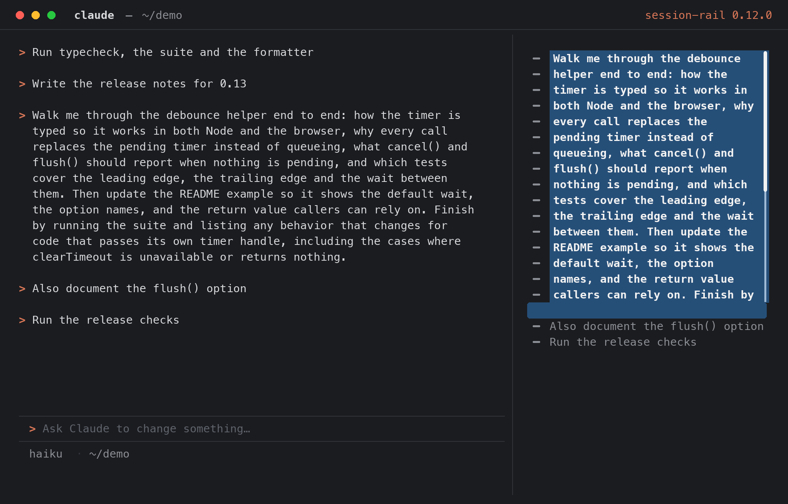
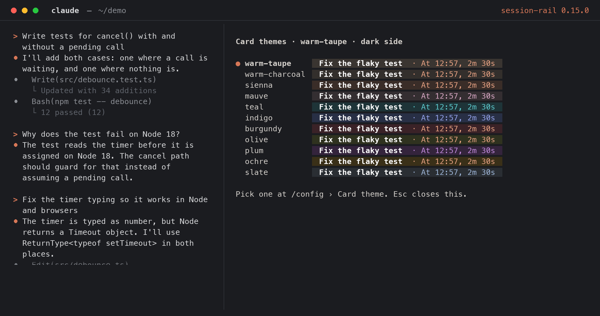
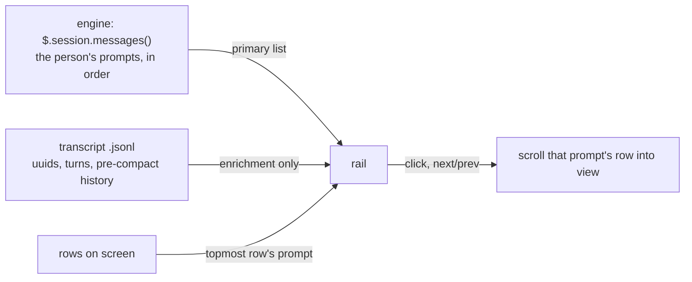

<div align="center">

# session-rail

A rail of your prompts for Claude Code. Hover to read one, click to jump back to it.

**English** · [简体中文](README.zh-CN.md)


</div>

> **Fork.** session-rail is a fork of [prompt-rail](https://github.com/oikon48/prompt-rail) by oikon48, under the MIT license. The rail, layouts, commands and settings are prompt-rail's. The history source is rebuilt: the engine's own message list (`$.session.messages()`) now leads, and the transcript file enriches it with ids, turn details and history older than the engine keeps. See [docs/refactor-comparison.md](docs/refactor-comparison.md) for what changed and why.

## Quick start

session-rail is a mod, so it needs Claude Code 2.1.287 or later, where mods are on by default. If you set `CLAUDE_CODE_ENABLE_FUNCTION_HOOKS` during early access, you can remove it, since Claude Code now ignores it.

1. Install from the marketplace, inside a session:

   ```
   /plugin marketplace add hfwang0318/session-rail
   /plugin install session-rail@hfwang
   ```

   Or from your shell, with a checkout of this repository:

   ```bash
   claude plugin marketplace add /path/to/session-rail
   claude plugin install session-rail@hfwang
   ```

   For development, load the plugin straight from the checkout instead:

   ```bash
   claude --plugin-dir /path/to/session-rail/plugins/session-rail
   ```

2. Start a new session. The rail opens on its own.

Mouse works best with `"tui": "fullscreen"`.

## Three layouts

### Horizontal, above the prompt


### Vertical, beside the transcript (default)


Where the pane has room for text and at least one row to show under it, it opens with `started at 2026-11-14 14:41:10`, when the conversation started, to the second. Scrolling the transcript back through its history makes the matching prompt's row bold, so the turn in view is marked even when its row sits below the fold; when the list is taller than the pane, the pane's own window moves to keep that row in view. A slash command sent with arguments, such as `/impeccable …`, is listed as the command line; a local command such as `/model` or `/config` is not. A resumed session shows the original conversation's start, where a transcript can be read, not the moment it was resumed, and draws a `resumed at 2026-11-14 06:05:00` line at the prompt text's column above the first prompt sent after each resume it was told of: everything over the last line is the history the session brought, and the prompts of each resumed run stay together. A line with nothing from before the resume above it is not drawn; an empty list still shows the latest, marking where the first prompt will begin. The lines survive a reload and are kept for the next process, for the 20 most recent sessions; a `/clear` removes them. A `/resume` the module is never told of adds no line for that moment, though lines kept from earlier resumes still draw.

### Below, under the prompt

The bars sit on a row of their own under the hint line below the prompt input, next to the status line, with the prompt being read beside them. `‹` and `›` step to the previous or next prompt. The hint line above them is Claude Code's own, so its mode label and hints stay as they are.


<details>
<summary>The below layout in motion</summary>


</details>

## Hover cards

Hovering a prompt opens its card. A prompt too long for its row or bar is shown whole there, wrapped; a prompt the row already holds whole is not repeated, so the card carries only its stats. Under the prompt, the card names when it was sent — the clock time for today, the date and time for an older prompt — then how long its turn took, how it ended, and the files it edited. The "Expand on hover" row in `/config` turns the cards off, on by default.

The "Scroll on hover" row in `/config` (off by default) scrolls a cut prompt in place on one line instead of expanding it: in the pane the hovered row itself scrolls, and only the stats line opens beneath it; in the band the prompt scrolls beside them. The moving row is the terminal's, and the band's moving line is the terminal's and the desktop app's; a surface with no live region keeps the cut card. It reads with "Expand on hover".

In the pane the card opens under the hovered row, and the row and the card share one panel: the same background, the same bright prompt text, the row's cut text running on into the card. A blank panel line sets the rest of a cut prompt apart from its stats; a prompt the row holds whole takes the stats alone. A prompt too long for the card's room opens on the roomier side as a window with a scrollbar on its right edge, and its stats stay pinned at the card's foot, so they are read without scrolling the prompt above them. A prompt whose text has line breaks keeps them, and its indentation, in the card, and is shown whole even under its row, so code and lists read as themselves rather than as one run of words. A card that opens above its row carries the whole prompt from its first line and blanks its row while hovered, so the prompt reads top-down in one place; the blank row still jumps when pressed. The wheel over the card, or over its row, scrolls the card's lines instead of the rail's rows. The prompt is drawn in a highlight brighter than the rail's body text — white in dark themes, black in light ones — and the row under the pointer takes the same color, so hovering lifts the prompt itself and not only its panel. The pane's stats line reads as a sentence — `At 12:57, ran 2m 30s and changed 5 files`, `At 12:57, still running` — in the card's accent tint, regular, so the highlight stays the card's brightest line. If a custom "Hover card background" cannot carry the highlight, the prompt and the hovered row fall back to whichever white or black the panel can carry; setting "Hover card text" uses that color for the prompt and the row, and — unless "Hover card stats text" is set — for the stats line too. The "Hover card background" and "Hover card text" rows in `/config` set the panel in every layout — a theme key such as `inactive`, or a raw color — and empty follows the "Card theme" family's variant for the active color scheme (the default `warm-taupe` is `#3A3531` behind `#D4D0CB` in a dark theme, `#E8E1D8` behind `#35312D` in a light one), the same body color as the rail's ordinary rows, so the panel and its row read as one surface. The pointer still reaches the next row: the panel leaves the first three columns clear, and while the panel is open the hovered row hides its trailing `…`, which comes back when the pointer leaves.

### A card too tall for its room



The prompt near the bottom of the pane has no room under it, so its card opens above: the whole prompt, from its first line, then the blank line, then the stats — and the row itself goes blank, so nothing repeats at the bottom of the card. The rows the card covers keep their ticks in the first three columns, and the scrollbar turns the rest of the prompt when the wheel moves over the card or over its blank row.

<details>
<summary>The tall card in motion: the wheel scrolls it</summary>


</details>

## Commands

| Command | |
| --- | --- |
| `/session-rail horizontal` | Bars above the prompt input |
| `/session-rail vertical` | A pane beside the transcript |
| `/session-rail below` | Bars under the hint line below the prompt input |
| `/session-rail off` | Hide the rail |
| `/session-rail next` | Jump to the next prompt |
| `/session-rail prev` | Jump to the previous prompt |
| `/session-rail first`, `last` | Jump to the first or the newest prompt |
| `/session-rail 12`, `#12` | Jump to prompt #12 |
| `/session-rail find <words>` | Jump to the newest prompt that holds the words |
| `/session-rail preview` (`preview theme`) | Open a preview pane with every card theme sampled in the current color scheme |
| `/session-rail-next`, `/session-rail-prev` | Jump to the next or previous prompt, with no argument, for a keybinding |
| `/session-rail-toggle` | Hide the rail, or bring it back in the layout last on, with no argument, for a keybinding |
| `/session-rail-preview` | Open the theme preview pane, for every card theme or the one named, as `/session-rail-preview sienna` |
| `/session-rail` | Reopen the rail in the current layout |

The layout is also the "Rail mode" row in `/config`, and it is kept across sessions. Switching it with `/session-rail <layout>` also draws where the rail now sits around the prompt input. The "Expand on hover" row turns the hover cards on or off; they are on by default, and the "Scroll on hover" row scrolls the prompt on one line instead of expanding it. The "Color scheme" row picks the rail's palette: `auto` (the default) follows the `/config` theme — a built-in name says whether it is light or dark, and a custom theme is read from its definition's `base` — and switches as soon as the theme does, without a restart; `dark` or `light` fixes one, for a custom theme the rail cannot read. The "Card theme" row picks the color family of the hover card and the row or bar under the pointer: `warm-taupe` (the default), `warm-charcoal`, `sienna`, `mauve`, `teal`, `indigo`, `burgundy`, `olive`, `plum`, `ochre` or `slate`. Each family carries a dark and a light panel, and "Color scheme" decides which side is drawn, so the pair switches with the theme; a raw "Hover card background" still overrides the family. "Accent follows card theme" (on by default) decides whether the accent — the prompt being read, the `compacted` divider, the `started at …` / `resumed at …` lines, the hover card's stats line and the marquee seam — takes the family's own accent or stays Claude's orange. The Card theme row's help text in `/config` describes the selected family and the current side. `/session-rail-preview` (or `/session-rail preview`, also `preview theme`) opens a preview pane with all eleven as sample prompts on their panels, in the current scheme's highlight and accent tint, with the family in use marked; name one, as in `/session-rail-preview sienna`, to see that family alone as a two-line card. Esc closes the pane, and no color values are printed.

### Keyboard

Bind the step commands in `~/.claude/keybindings.json`; they run mid-turn too:

```json
{
  "bindings": [
    { "context": "Chat", "bindings": { "ctrl+k": "command:session-rail-prev", "meta+j": "command:session-rail-next" } }
  ]
}
```

In the horizontal layout, `ctrl+x tab` moves the focus to the bars: the ring starts on the prompt you are reading, `←` `→` move it across the bars on screen and show its prompt, `Enter` jumps there, `Esc` returns to the prompt input.

While a prompt's turn is still running, its row sits above the reply being written; a jump to that prompt goes to the newest reply row instead, the live end of the transcript, at the bottom of the view (or at the top of that row when the reply is taller than the view).

## Tick legend

| Tick | Meaning |
| --- | --- |
| `━` `┃` | The prompt you are reading |
| `─` `│` | Any other prompt |
| `┄` `┆` | A prompt Claude Code refused to scroll to; `next` and `prev` skip it |
| `⌁` / `compacted` | The prompt that opens the segment after a `/compact` |
| `⠋` `⠙` `⠹` … | Its turn is running; the tick spins in place |

| Color | Meaning |
| --- | --- |
| accent | The prompt you are reading, the `compacted` divider, and the `started at …` / `resumed at …` lines: Claude orange `#D77757` / `#9E4422`, or the card family's own accent when "Accent follows card theme" is on (see below) |
| accent on card | A hover card's stats line and the marquee seam: the card family's accent, or `#E6A182` / `#9E4422` with Claude orange |
| card highlight | A hover card's prompt and the row or bar under the pointer: `#FFFFFF` in dark themes, `#000000` in light ones; a custom panel that cannot carry it falls back to whichever white or black it can |
| body text | The rail's rows, labels and a card's chrome: `#D4D0CB` in dark themes, `#35312D` in light ones |
| card panel | The hover card and selected row: the "Card theme" family's dark or light variant (default `warm-taupe`: `#3A3531` / `#E8E1D8`) |
| green | Its turn is running |
| yellow | The turn was interrupted |
| red | The turn ended with an API error |
| gray | Claude Code refused to scroll to it |

The rail ships two palettes, dark and light, and the "Color scheme" row in `/config` chooses between them. On `auto` it reads the `/config` theme: a built-in name says its side — `light` or `solarized-light` gets the light palette, `dark` or `dark-daltonized` the dark one — and a custom theme is read from the `base` field of its definition (`themes/<name>.json` under the config folder), so a custom light theme gets the light palette even though its name says nothing. The accent is Claude's orange family by default: `#D77757` is the `claude` theme key's color in the dark themes, and the light palette darkens it to `#9E4422` so it reads on a warm white page. A hover card's prompt and its hovered row draw a highlight brighter than body text — `#FFFFFF` in dark themes, `#000000` in light ones — while its stats line takes the card family's accent tint, so the prompt is the card's brightest line and the row and its card still read as one surface. The status colors are theme keys, so they follow the person's theme; a hover card still names the turn's outcome in words.

The "Card theme" row picks the panel's color family. Every family is a pair, and "Color scheme" draws the matching side:

| Card theme | dark | light | accent (dark / light) | Character |
| --- | --- | --- | --- | --- |
| `warm-taupe` (default) | `#3A3531` | `#E8E1D8` | `#D77757` / `#9E4422` | Warm brown-grey |
| `warm-charcoal` | `#332F2C` | `#E5DED6` | `#D77757` / `#9E4422` | Quieter warm neutral |
| `sienna` | `#3A2D28` | `#EBDDD4` | `#D77757` / `#9E4422` | Red-brown, tied to the accent |
| `mauve` | `#342E31` | `#E5DDE0` | `#D8A8C4` / `#7A3A62` | Warm grey with a plum cast |
| `teal` | `#1E3438` | `#D8E8E5` | `#5CC8CC` / `#0E6A70` | Blue-green |
| `indigo` | `#282F45` | `#DEE3F4` | `#93A2E8` / `#3A4FA3` | Navy |
| `burgundy` | `#3A2227` | `#F1DEE3` | `#D77757` / `#9E4422` | Deep red |
| `olive` | `#2F321F` | `#E5E7D3` | `#D77757` / `#9E4422` | Grey-green |
| `plum` | `#34243C` | `#EBE0F3` | `#C08ADB` / `#6E3F9E` | Deep purple |
| `ochre` | `#3A3018` | `#F3E8D0` | `#D77757` / `#9E4422` | Yellow-brown |
| `slate` | `#2A2E33` | `#DEE2E6` | `#9DB4D6` / `#3F5A7A` | Cool neutral |

With "Accent follows card theme" on (the default), the accent takes the family's column: the cool and purple families (`mauve`, `teal`, `indigo`, `plum`, `slate`) draw in their own hue, while the warm families and the ones whose hue would read as a status color (`burgundy` on error red, `olive` on running green, `ochre` on interrupted yellow) keep Claude's orange so "the prompt being read" stays distinct from "what happened". Turning the row off fixes Claude's orange for every family.

Every pairing is checked on its own side: body text, the prompt highlight and the stats accent all clear the body-text contrast floor, so a family changes the panel's character without making the card harder to read. Across all eleven families the body text stays at `7.9:1` or better in dark themes and `9.7:1` or better in light ones, the prompt highlight at `12.1:1` / `15.8:1` or better, and the stats accent at `5.4:1` / `4.8:1` or better; a custom panel the highlight or accent cannot carry falls back to whichever white or black it can, at body-text contrast or better. A raw "Hover card background" still overrides the family; pair it with "Hover card text" if it is a theme key or a color name the rail cannot measure.

### Previewing the card themes



`/session-rail-preview` opens this pane with all eleven families sampled in the current scheme; name one, as in `/session-rail-preview sienna`, for a single two-line card. The family in use is marked, and Escape closes the pane. No color values are printed: the sample is the explanation.

Three weights carry the hierarchy. Semibold marks the one thing being read: the prompt on screen, the row or bar under the pointer, a card's prompt, and the label inside the band's ring. Regular is everything else — ordinary rows, stats, times and chrome — and dim marks secondary text such as a row off the prompt being read. Inverse appears only for a moment, while a jump shows the row it landed on. Underline, italic and strikethrough are not used. A terminal draws semibold and bold alike, so the distinction is visual weight rather than a named style.

## How it works

<details>
<summary>From the engine's message list and the transcript to the rail</summary>



The engine's message list is the rail's primary source. It names the person's prompts in conversation order without reading a file, so the list survives a transcript that is missing, renamed, still being written, or read too late after a `/clear`. The transcript is read as an optional second source: it supplies the uuid each prompt is stored under (so a jump can address its row), each prompt's turn details, and prompts older than the engine's 4096-entry window. A transcript read can add to the engine's list but never empty it.

A compaction replaces the engine's list with a summary message plus the most recent rows, so the rail filters that summary out and restores the prompts before the boundary from the transcript. Prompts abandoned with `/rewind` still drop out: the transcript read follows only the live branch.

A session continued into another — by `/resume`, or by a context overflow Claude Code carried forward — opens its transcript with a summary row that names the session it continued. The rail reads that transcript from the same folder, puts its prompts before this session's, and drops the rows the continuation copied. Reading is on demand: a `[ click to load more prompts from parent session <id> ]` primary button sits above the oldest prompt and reads one session per press, returning while a further session waits (up to four back). Those prompts' rows live in the other transcript, so they draw with the dotted tick and `next`/`prev` skip them; pressing one says why instead of leaving a failed scroll. The block is headed `prompts from <id> ⧉` — a press copies the full id, the one `/resume` takes — and this session's own part is headed `current session`; each heading carries its session's start time (`11-15 17:10`) flush with the pane's right edge, so the blocks' times line up and every session is dated at its first prompt. The band and the below line have no row to head, so a `⇡` on the first prompt of each block stands in.

A jump addresses the uuid the transcript stores for a prompt. Where no transcript can be read, the rail records the request id the prompt's row was drawn under, and matches a prompt restored without one to the engine's list by its text, so a click still lands. The transcript is found by the classic hooks where they run, and otherwise by session id under `CLAUDE_CONFIG_DIR` or `~/.claude`.

The prompt you are reading owns the topmost row on screen. The transcript is read again only when its size or time changed.

</details>

## Limitations

<details>
<summary>Known limits</summary>

- The mods API may still change between Claude Code releases.
- The hover card is drawn in every layout; in the vertical layout its prompt wraps to the pane's width.
- The below rail is the terminal's. The Claude desktop app draws it above the prompt, as the horizontal rail.
- The Claude desktop app draws the horizontal rail and its hover cards, but a click cannot jump there. The app gives a plugin no way to scroll its transcript, so the rail says so once a session. The prompt being read is named beside the bars rather than on the line above them, since the app paints a card over that line without hiding what is under it. Checked with Claude Code 2.1.280, the app did not draw the vertical pane.
- The dock width is shared by all plugin panes; drag its edge to narrow it, down to 24 columns.
- A `/compact` command's own row cannot be jumped to; its tick turns dotted after the first try.
- The `click to load more prompts from parent session` row is drawn by the pane, so an earlier session is offered in the vertical layout. The band and the below line mark each block start with `⇡` once the pane has loaded a level, but cannot ask for one themselves.
- Near the end of the transcript, `next` cannot scroll further.
- After a compaction, the engine keeps only the summary and the most recent messages. Prompts before the boundary are listed from the transcript; where no transcript can be read at all, they cannot be listed in that session.
- With no transcript to read, a prompt can be jumped to only after its row has been drawn once, since the engine's list carries no row id of its own.
- A `/resume` the module is never told of — a new process launched with the classic hooks passed over — adds no line for that moment, and with no readable transcript the pane's head names the moment the module loaded rather than the conversation's original start. An in-process `/resume` is told of through `session.end`, so it draws its line. The moments a conversation was resumed at are kept in the mod's store for the 20 most recent sessions and in the engine's session state, so a hot reload and a new process keep its lines; the hash-keyed prompt counts live only in the session state, so a new process places the latest line by the transcript's timestamps. Up to 256 moments and 256 distinct prompt texts are kept.

</details>

## Development

```bash
claude --plugin-dir plugins/session-rail        # load this checkout; saving reloads it
claude plugin validate plugins/session-rail
claude plugin test plugins/session-rail
```

Run `/plugin-types .claude/types` in a session here for type declarations. Bump the version in `plugins/session-rail/.claude-plugin/plugin.json` with each release, since installed copies update only when it changes.

The pictures in this README are drawn by `docs/make-assets.py` (Pillow), not captured from a terminal, so they can be regenerated after a UI change:

```bash
python3 docs/make-assets.py
```

The Claude directory listing tracks the `release` branch rather than `main`, so merged changes reach it only when a release is pushed there. After a Release PR merges, publish it with:

```bash
git push origin main:release
```

The directory picks the new commit up within about six hours and scans it before it goes live.

## License

[MIT](LICENSE), Copyright (c) 2026 oikon48. This fork keeps the same license and adds its changes under it.
