<div align="center">

# session-rail

为 Claude Code 准备的提示词轨道。悬停即可通读一条提示词，点击就能跳回它。

[English](README.md) · **简体中文**


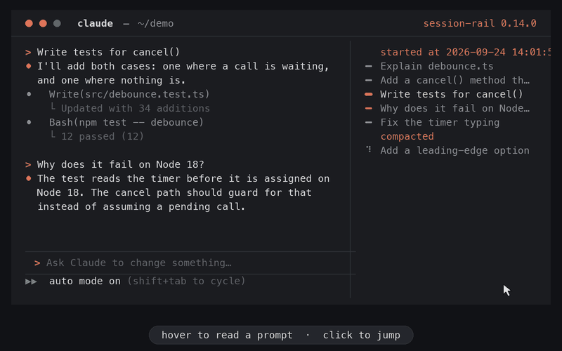

</div>

> **派生版本。** session-rail 是 oikon48 的 [prompt-rail](https://github.com/oikon48/prompt-rail) 的派生版本，沿用 MIT 许可证。rail 本身、布局、命令和设置都来自 prompt-rail。历史来源被重建了：现在由引擎自己的消息列表（`$.session.messages()`）作为主来源，对话记录文件则为它补充 id、回合详情，以及早于引擎保留范围的历史。改动内容与原因见 [docs/refactor-comparison.md](docs/refactor-comparison.md)（中文）。

## 快速开始

session-rail 是一个 mod，因此需要 Claude Code 2.1.287 或更高版本——在这些版本中 mod 默认开启。如果你在早期试用阶段设置过 `CLAUDE_CODE_ENABLE_FUNCTION_HOOKS`，现在可以删掉它，Claude Code 已不再读取它。

1. 在会话中从插件市场安装：

   ```
   /plugin marketplace add hfwang0318/session-rail
   /plugin install session-rail@hfwang
   ```

   或者在 shell 中，用本仓库的检出目录安装：

   ```bash
   claude plugin marketplace add /path/to/session-rail
   claude plugin install session-rail@hfwang
   ```

   开发时，也可以直接从检出目录加载插件：

   ```bash
   claude --plugin-dir /path/to/session-rail/plugins/session-rail
   ```

2. 开始一个新会话。rail 会自行打开。

鼠标操作在 `"tui": "fullscreen"` 下效果最佳。

## 三种布局

### 纵向：对话记录旁（默认）

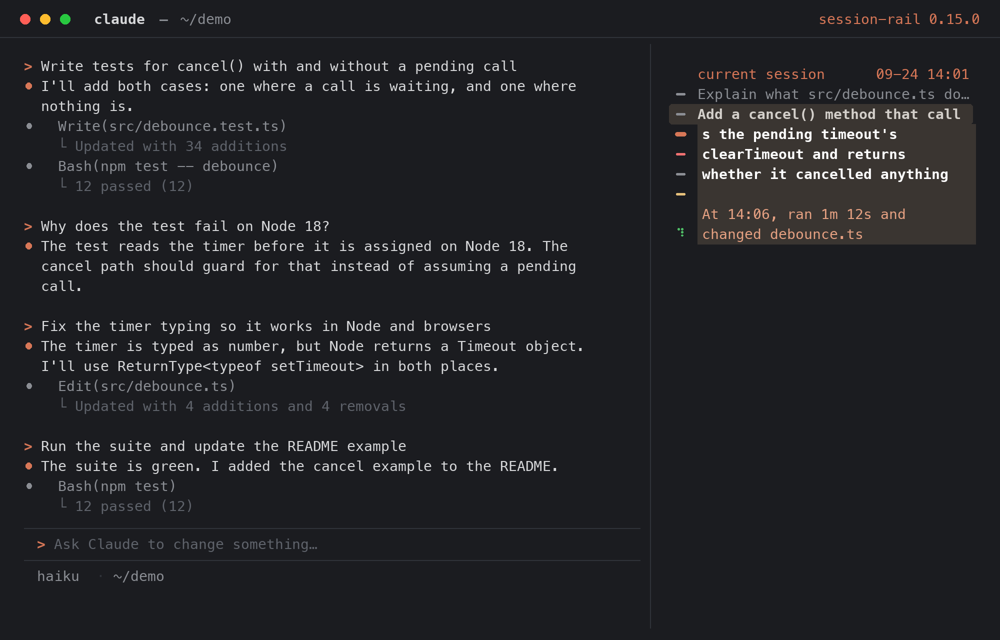

`/session-rail vertical`。每条提示词一行，位于对话记录旁边。粗体的那一行就是正在阅读的提示词。

### 横向：提示词上方

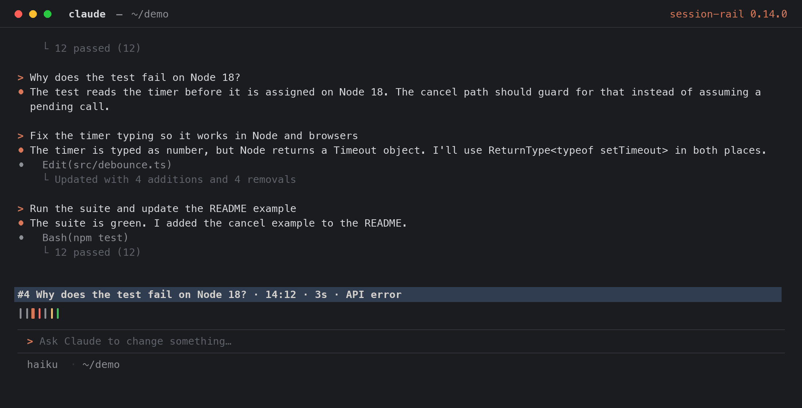

`/session-rail horizontal`。提示词输入框上方的一排横条。

### 下方：提示行下方

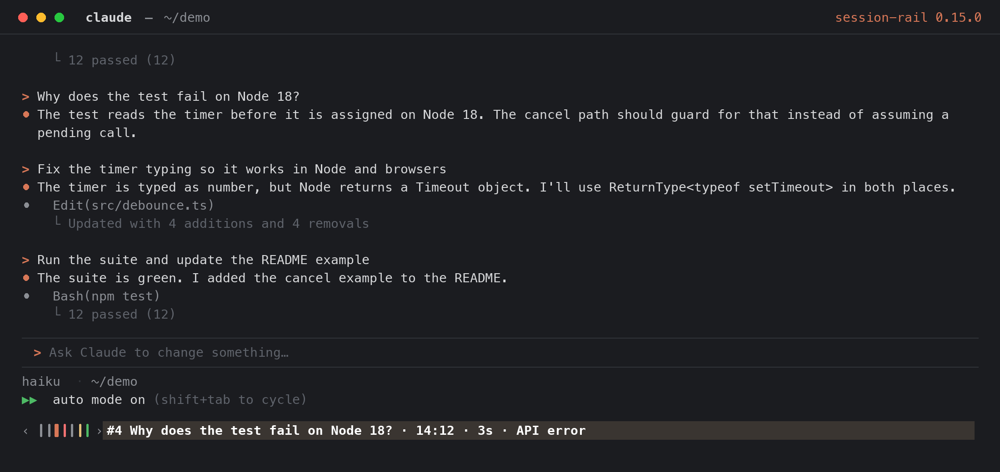

`/session-rail below`。横条位于状态行旁、提示词输入框下方。

<details>
<summary>下方布局的动态效果</summary>

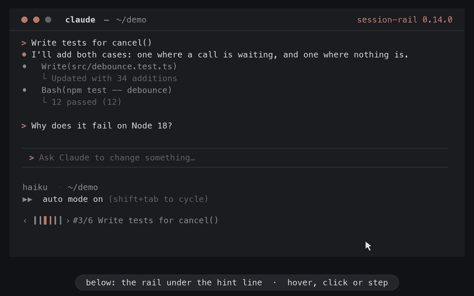

</details>

## 悬停阅读，点击跳转

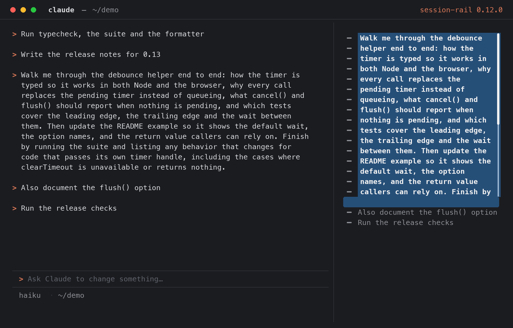

- **悬停**一条被截断的提示词：看到全文、发送时间、回合时长、结局和改动过的文件。
- **点击**任意一行或一根横条：对话记录跳转过去，该行闪一下。
- 正在运行的回合会旋转刻度；Claude Code 拒绝滚动到的提示词会变成点线刻度，`next`/`prev` 会跳过它。

<details>
<summary>高卡片滚动起来的样子</summary>

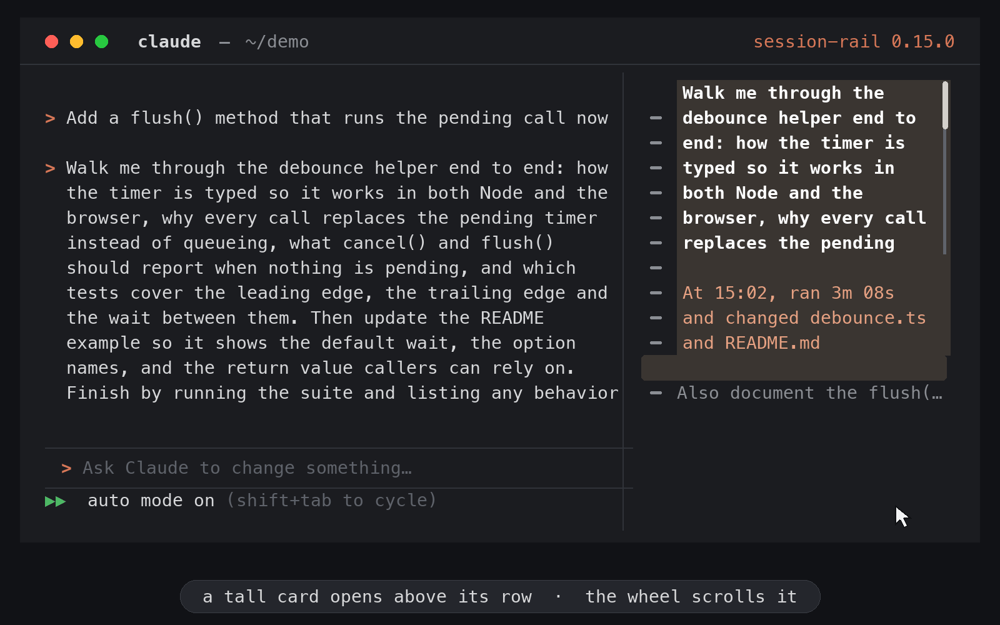

</details>

<details>
<summary>悬停卡片细节</summary>

提示词比卡片空间更高时，会在空间更大的一侧打开为带滚动条的窗口，统计信息固定在卡片底部。打开在行上方的卡片从第一行起展示完整提示词，并在悬停时把该行留空。滚轮停在卡片或其行上时滚动卡片，而不是 rail。`/config` 中的 “Expand on hover”、“Scroll on hover”（用一行跑马灯代替展开）、“Hover card background”、“Hover card text” 和 “Hover card stats text” 都可以调整它。卡片在所有布局中都会绘制；承载不了高亮提示词的自定义面板会退回它能承载的黑或白。

</details>

## 长会话

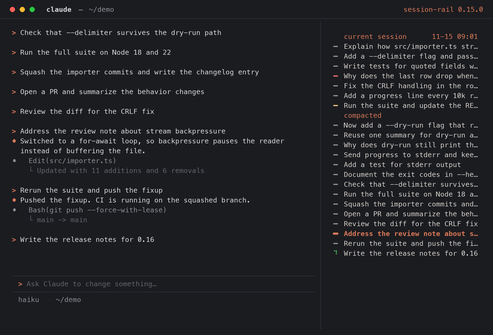

不管二十条还是两百条提示词，rail 始终是这次会话的地图：

- `/compact` 处会有一条 `compacted` 隔断，它之前的提示词从对话记录恢复，列表不会缩到引擎保留的窗口那么大。
- 向上滚动对话记录时，粗体行随之移动；列表高于面板时，面板自己的窗口会跟着移动。
- 用编号（`/session-rail 12`）、按词查找（`/session-rail find migration`），或用 `next`/`prev` 跳转。

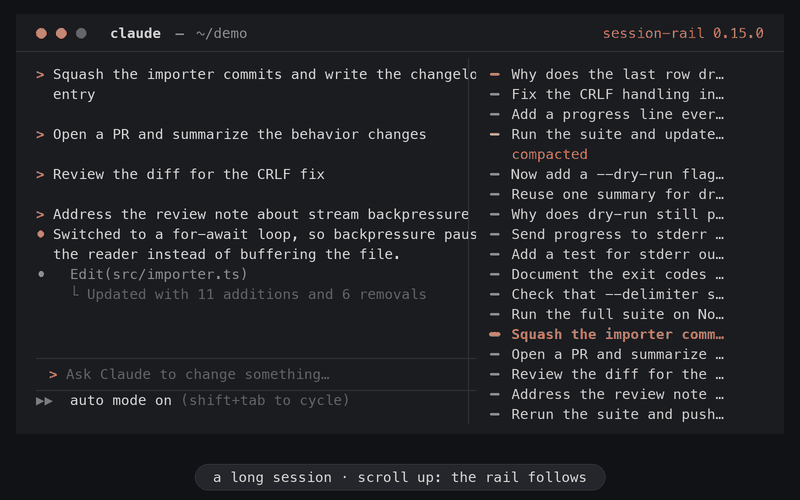

## 恢复、续接与 fork

一段对话可以跨越多个进程。rail 会把接缝画出来。

### 恢复

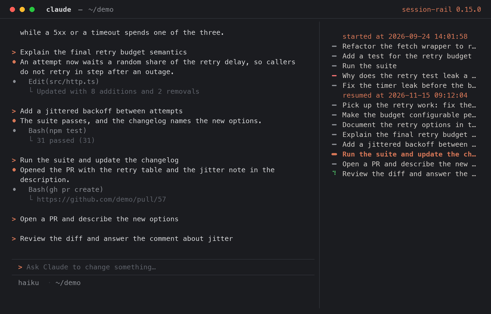

`/resume` 会在新一段运行的第一条提示词上方画一条 `resumed at …`。头部仍是最初的开始时间，而不是恢复的那一刻。

### fork 或上下文溢出

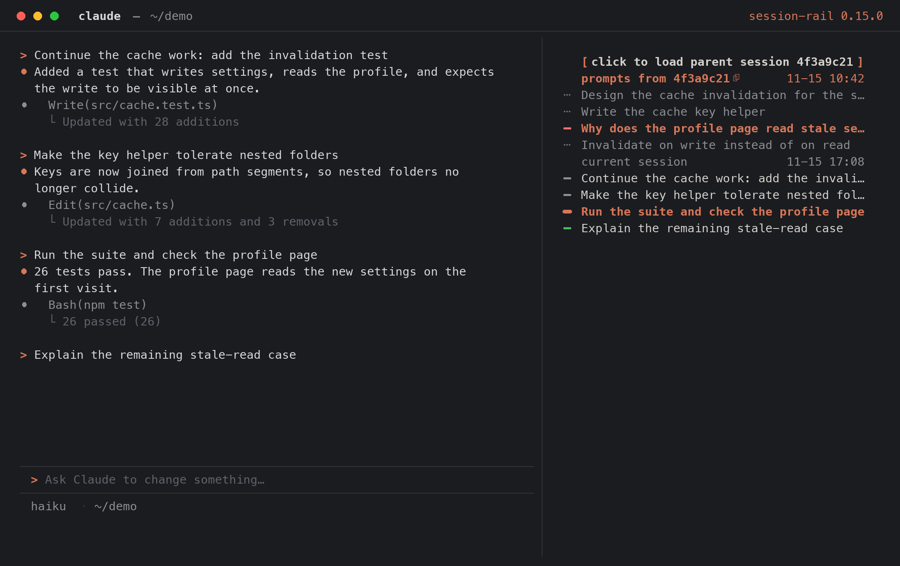

用 `claude --resume <id> --fork-session` fork，或因为上下文溢出开启新会话时，rail 把两段显示为一段对话，较早的会话自成一块：

- `prompts from <id> ⧉` 是更早会话的标题，右侧标出它的开始时间。块内的行是点线刻度：跳转到不了它们，按下会说明原因；按下标题则复制完整 id。
- `current session` 是本会话自己那一段的标题。
- `[ click to load parent … ]` 每按一次加载一层更早的会话，最多上溯四层。不问就不读。

<details>
<summary>逐层加载更早的会话（动图）</summary>


</details>

## 颜色与主题

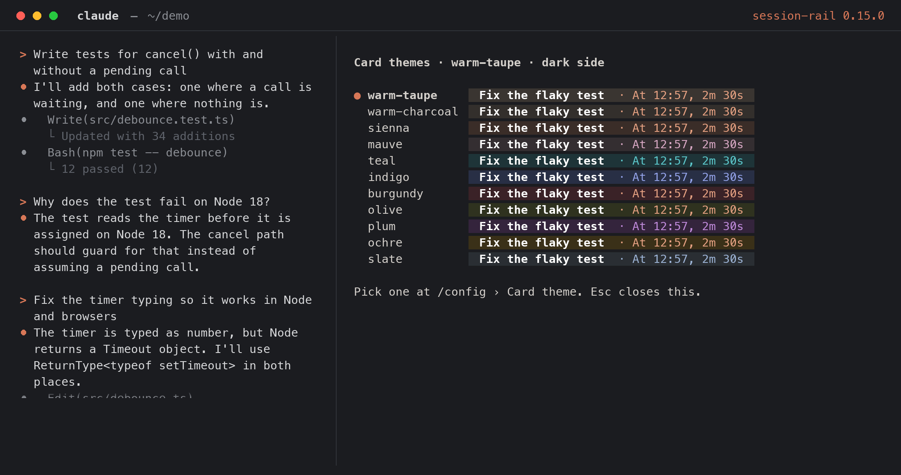

深色和浅色两套色板，由 “Color scheme” 选择（`auto` 跟随 `/config` 主题）。十一种卡片家族，每个都有深色和浅色两侧。`/session-rail-preview` 会按当前方案展示它们。

<details>
<summary>同一张卡片走遍十一种家族（动图）</summary>


</details>


<details>
<summary>十一种家族及它们的颜色</summary>

| 卡片主题 | 深色 | 浅色 | accent（深色 / 浅色） |
| --- | --- | --- | --- |
| `warm-taupe`（默认） | `#3A3531` | `#E8E1D8` | `#D77757` / `#9E4422` |
| `warm-charcoal` | `#332F2C` | `#E5DED6` | `#D77757` / `#9E4422` |
| `sienna` | `#3A2D28` | `#EBDDD4` | `#D77757` / `#9E4422` |
| `mauve` | `#342E31` | `#E5DDE0` | `#D8A8C4` / `#7A3A62` |
| `teal` | `#1E3438` | `#D8E8E5` | `#5CC8CC` / `#0E6A70` |
| `indigo` | `#282F45` | `#DEE3F4` | `#93A2E8` / `#3A4FA3` |
| `burgundy` | `#3A2227` | `#F1DEE3` | `#D77757` / `#9E4422` |
| `olive` | `#2F321F` | `#E5E7D3` | `#D77757` / `#9E4422` |
| `plum` | `#34243C` | `#EBE0F3` | `#C08ADB` / `#6E3F9E` |
| `ochre` | `#3A3018` | `#F3E8D0` | `#D77757` / `#9E4422` |
| `slate` | `#2A2E33` | `#DEE2E6` | `#9DB4D6` / `#3F5A7A` |

开启 “Accent follows card theme”（默认）时，`mauve`、`teal`、`indigo`、`plum`、`slate` 会连 accent 一起染色；暖色家族保留 Claude 的橙色，使 accent 与绿、黄、红三种状态色保持区别。每一对颜色都在各自一侧通过了正文对比度下限。

</details>

## 命令

| 命令 | |
| --- | --- |
| `/session-rail horizontal` | 提示词输入框上方的横条 |
| `/session-rail vertical` | 对话记录旁的面板 |
| `/session-rail below` | 提示词输入框下方提示行下的横条 |
| `/session-rail off` | 隐藏 rail |
| `/session-rail next` | 跳到下一条提示词 |
| `/session-rail prev` | 跳到上一条提示词 |
| `/session-rail first`、`last` | 跳到第一条或最新一条提示词 |
| `/session-rail 12`、`#12` | 跳到第 12 条提示词 |
| `/session-rail find <words>` | 跳到包含这些词的最新一条提示词 |
| `/session-rail preview`（`preview theme`） | 打开预览面板，按当前配色方案展示每一种卡片主题的示例 |
| `/session-rail-next`、`/session-rail-prev` | 无参数跳到下一条或上一条提示词，供键位绑定使用 |
| `/session-rail-toggle` | 隐藏 rail，或以最后使用的布局重新显示，无参数，供键位绑定使用 |
| `/session-rail-preview` | 打开主题预览面板，展示全部卡片主题，或指定的一个，例如 `/session-rail-preview sienna` |
| `/session-rail` | 以当前布局重新打开 rail |

布局也对应 `/config` 中的 “Rail mode”。主题相关的行有 “Color scheme”、“Card theme”、“Accent follows card theme”、“Expand on hover”、“Scroll on hover”、“Hover card background”、“Hover card text” 和 “Hover card stats text”。

<details>
<summary>/config 各行细节</summary>

“Color scheme” 行选择 rail 的色板：`auto`（默认）跟随 `/config` 主题——内置名会说清它是浅色还是深色，自定义主题则读取其定义中的 `base`——主题一变就切换，无需重启；`dark` 或 `light` 固定一种。“Card theme” 行选择悬停卡片以及指针下的行或横条的颜色家族；每个家族都带深色和浅色面板，“Color scheme” 决定画哪一侧。“Accent follows card theme” 决定 accent——正在阅读的提示词、`compacted` 隔断、`started at …` / `resumed at …` 线、卡片统计行和跑马灯接缝——采用家族自己的 accent，还是保持 Claude 的橙色。“Expand on hover” 开关卡片；“Scroll on hover” 改为一行滚动。“Hover card background” 和 “Hover card text” 接受主题键或原始颜色，留空则跟随当前方案下家族的变体。自定义面板承载不了高亮色时，会退回它能承载的黑或白。

</details>

### 键盘

在 `~/.claude/keybindings.json` 中绑定步进命令；它们在回合进行中也能运行：

```json
{
  "bindings": [
    { "context": "Chat", "bindings": { "ctrl+k": "command:session-rail-prev", "meta+j": "command:session-rail-next" } }
  ]
}
```

在横向布局中，`ctrl+x tab` 会把焦点移到横条上：`←` `→` 在横条间移动，`Enter` 跳转，`Esc` 回到提示词输入框。

## 刻度图例

| 刻度 | 含义 |
| --- | --- |
| `━` `┃` | 正在阅读的提示词 |
| `─` `│` | 其他任何提示词 |
| `┄` `┆` | Claude Code 拒绝滚动到的提示词；`next` 和 `prev` 会跳过它 |
| `⌁` / `compacted` | `/compact` 之后开启新分段的提示词 |
| `⇡` | 横条与下方行中，更早会话那一块的第一条提示词 |
| `⠋` `⠙` `⠹` … | 其回合正在运行；刻度原地旋转 |

| 颜色 | 含义 |
| --- | --- |
| accent | 正在阅读的提示词、`compacted` 隔断，以及 `started at …` / `resumed at …` 线 |
| card highlight | 悬停卡片的提示词和指针下的行或横条：深色主题白色，浅色主题黑色 |
| body text | rail 的行、标签和卡片的装饰文字 |
| card panel | 悬停卡片和选中行，来自 “Card theme” 家族 |
| green | 其回合正在运行 |
| yellow | 回合被中断 |
| red | 回合以 API 错误结束 |
| gray | Claude Code 拒绝滚动到它 |

## 工作原理

<details>
<summary>从引擎的消息列表与对话记录到 rail</summary>

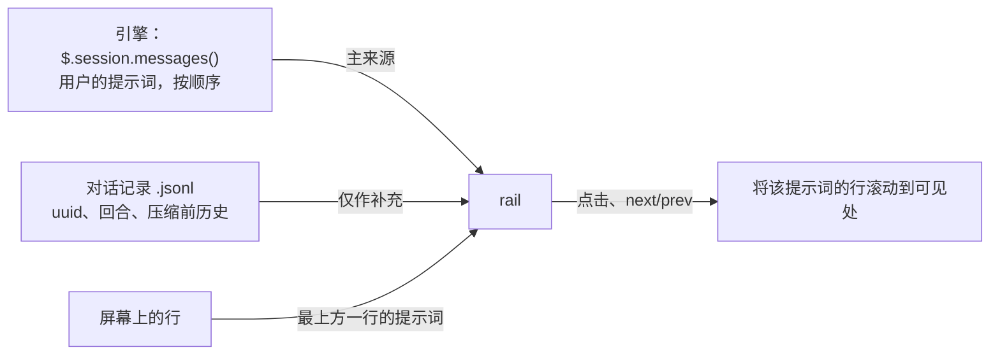

引擎的消息列表是 rail 的主来源。它无需读取文件，就能按对话顺序列出用户的提示词，因此即使对话记录缺失、被重命名、仍在写入，或在 `/clear` 之后读得太晚，列表依然存在。对话记录作为可选的第二来源读取：它提供每条提示词存储所用的 uuid（使跳转能够定位到它的行）、每条提示词的回合详情，以及早于引擎 4096 条窗口的提示词。读取对话记录可以为引擎的列表增加内容，但绝不能让它变空。

一次压缩会用一条摘要消息加上最近的若干行替换引擎的列表，因此 rail 会过滤掉该摘要，并从对话记录恢复边界之前的提示词。用 `/rewind` 放弃的提示词仍会消失：对话记录的读取只沿活动分支进行。

一个被续接到另一会话的会话——由 `/resume` 产生、用 `claude --resume <id> --fork-session` fork 出来，或因为上下文溢出被 Claude Code 延续——自己最新的文件开头有一行摘要，指明它所续接的会话。rail 会从同一目录读取那份对话记录，把它的提示词放到本会话之前，并去掉续接时复制过来的行。读取按需进行：最上方提示词之上有一个 `[ click to load more prompts from parent session <id> ]` 主按钮，每按一次读取一层会话；若更早的会话仍存在，这一行会再次出现（最多上溯四层）。那些提示词的行在另一份对话记录里，因此以点线刻度绘制，`next`/`prev` 会跳过它们；点击其中一条会说明原因，而不是留下一次失败的滚动。这一块的上方以 `prompts from <id> ⧉` 为标题——按下它会复制完整的 id，也就是 `/resume` 所接受的那个——本会话自己的部分则以 `current session` 为标题；每个标题右侧都带着该会话的开始时间（`11-15 17:10`，与面板右缘对齐），因此各块的时间连成一列，每个会话都按它第一条提示词标出开始时间。横条和下方行没有可放标题的位置，改为在每一块的第一条提示词上画一个 `⇡`。

跳转使用对话记录为提示词存储的 uuid。在无法读取对话记录的情况下，rail 会记录提示词的行当时所用的请求 id，并通过文本把没有该 id 的恢复提示词与引擎列表匹配，所以点击仍能落地。对话记录由 classic hooks 在其运行时定位，否则通过会话 id 在 `CLAUDE_CONFIG_DIR` 或 `~/.claude` 下查找。

正在阅读的提示词占据屏幕上最上方的一行。只有当对话记录的大小或时间发生变化时，才会再次读取它。

</details>

## 已知限制

<details>
<summary>已知限制</summary>

- mods API 在 Claude Code 各版本之间仍可能变化。
- 悬停卡片在所有布局中都会绘制；在纵向布局中，其提示词会按面板宽度折行。
- 下方 rail 属于终端。Claude 桌面应用会把它画在提示词上方，与横向 rail 相同。
- Claude 桌面应用会绘制横向 rail 及其悬停卡片，但点击无法在那里跳转。应用没有给插件提供滚动对话记录的途径，因此 rail 每个会话会提示一次。正在阅读的提示词显示在横条旁边，而不是上方那一行，因为应用会在那一行绘制卡片却不遮住其下方内容。以 Claude Code 2.1.280 检查时，应用不会绘制纵向面板。
- 停靠区宽度由所有插件面板共享；拖动其边缘可收窄，最窄到 24 列。
- `/compact` 命令自身的行无法跳转；首次尝试后其刻度会变为点线。
- `click to load more prompts from parent session` 这一行由面板绘制，因此较早的会话只在纵向布局中被提供。横条和下方行在面板加载过一层之后会用 `⇡` 标出各块起点，但自身无法请求加载。
- 在对话记录接近末尾时，`next` 无法继续滚动。
- 压缩之后，引擎只保留摘要和最近的消息。边界之前的提示词从对话记录列出；在完全无法读取对话记录时，它们无法在该会话中列出。
- 没有可读的对话记录时，提示词只有在它的行至少被绘制过一次之后才能跳转，因为引擎的列表本身不带行 id。
- 模块未被通知的 `/resume`——即 classic hooks 被跳过时启动的新进程——不会为那一刻添加线；在没有可读对话记录时，面板顶部标出的是模块加载的时刻，而不是对话最初的开始时间。进程内的 `/resume` 会通过 `session.end` 被通知，因此会画出它的线。对话被恢复的时刻保存在 mod 的 store 中（最近 20 个会话）和引擎的会话状态中，所以热重载和新进程都能保留这些线；以哈希为键的提示词计数只存在于会话状态中，因此新进程依据对话记录的时间戳放置最新一条线。最多保留 256 个时刻和 256 个不同提示词文本。

</details>

## 开发

```bash
claude --plugin-dir plugins/session-rail        # 加载本检出；保存即重载
claude plugin validate plugins/session-rail
claude plugin test plugins/session-rail
```

在会话中运行 `/plugin-types .claude/types` 可生成类型声明。每次发布都要提升 `plugins/session-rail/.claude-plugin/plugin.json` 中的版本号，因为已安装的副本只在版本变化时更新。

本 README 中的图片由 `docs/make-assets.py`（Pillow）绘制，并非终端截图，因此界面改动后可以重新生成：

```bash
python3 docs/make-assets.py
```

Claude 的插件目录跟踪 `release` 分支而不是 `main`，所以合并的改动只有在发布被推送到那里后才会到达目录。Release PR 合并后，用以下命令发布：

```bash
git push origin main:release
```

目录会在约六小时内拾取新提交，并在上线前进行扫描。

## 许可证

[MIT](LICENSE)，Copyright (c) 2026 oikon48。本 fork 沿用同一许可证，其改动也在该许可证下发布。
