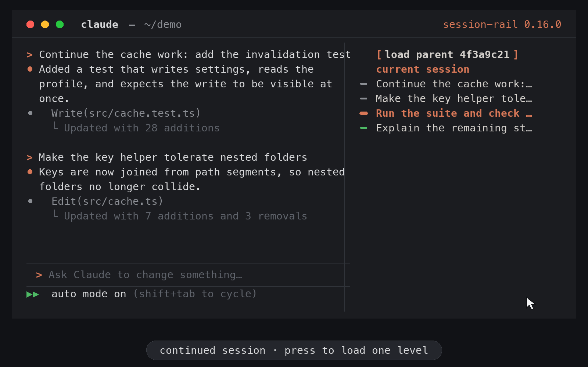
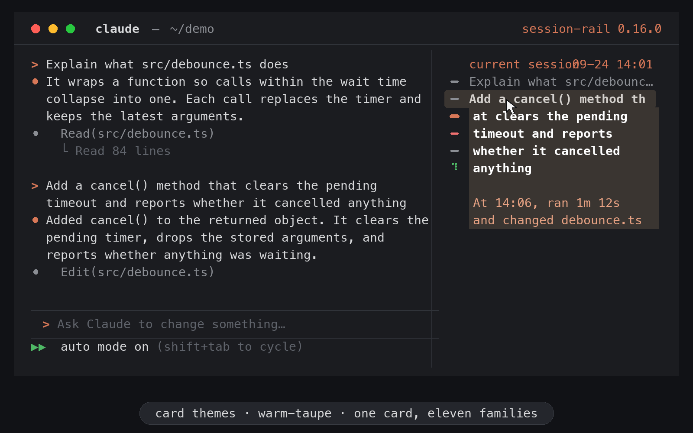
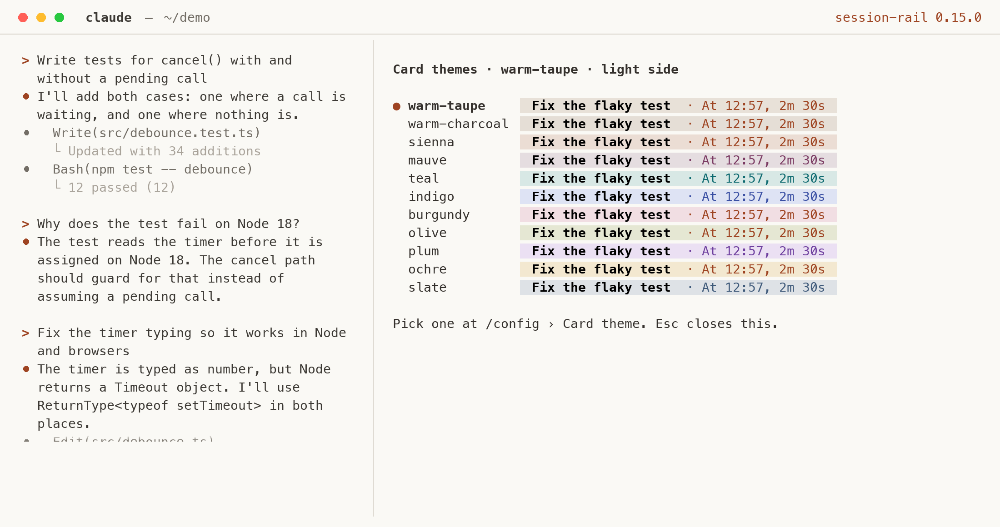
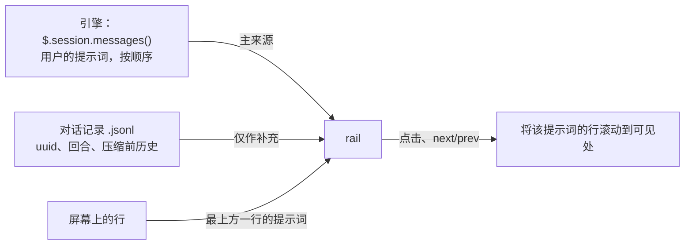

<div align="center">

# session-rail

为 Claude Code 准备的提示词轨道。悬停即可通读一条提示词，点击就能跳回它。

[English](README.md) · **简体中文**


</div>

> **派生版本。** session-rail 是 oikon48 的 [prompt-rail](https://github.com/oikon48/prompt-rail) 的派生版本，沿用 MIT 许可证。rail 本身、布局、命令和设置都来自 prompt-rail。历史来源被重建了：现在由引擎自己的消息列表（`$.session.messages()`）作为主来源，对话记录文件则为它补充 id、回合详情，以及早于引擎保留范围的历史。改动内容与原因见 [docs/refactor-comparison.md](docs/refactor-comparison.md)（中文）。

## 快速开始

session-rail 是一个 mod，因此需要 Claude Code 2.1.287 或更高版本——在这些版本中 mod 默认开启。如果你在早期试用阶段设置过 `CLAUDE_CODE_ENABLE_FUNCTION_HOOKS`，现在可以删掉它，Claude Code 已不再读取它。

1. 在会话中从插件市场安装：

   ```
   /plugin marketplace add hfwang0318/session-rail
   /plugin install session-rail@hfwang
   ```

   或者在 shell 中，用本仓库的检出目录安装：

   ```bash
   claude plugin marketplace add /path/to/session-rail
   claude plugin install session-rail@hfwang
   ```

   开发时，也可以直接从检出目录加载插件：

   ```bash
   claude --plugin-dir /path/to/session-rail/plugins/session-rail
   ```

2. 开始一个新会话。rail 会自行打开。

鼠标操作在 `"tui": "fullscreen"` 下效果最佳。

## 三种布局

### 横向：提示词上方


### 纵向：对话记录旁（默认）


当面板放得下文字、且下方至少还能显示一行时，它以 `started at 2026-11-14 14:41:10` 开头，标出对话开始的时间，精确到秒。向上滚动对话记录翻阅历史时，对应提示词所在的行会变为粗体，因此当前查看的回合即使其行位于可视区域之外也会被标出；当列表高于面板时，面板自己的窗口会移动以让该行保持可见。带参数发送的斜杠命令（例如 `/impeccable …`）会按命令行列出；`/model`、`/config` 这类本地命令则不列出。恢复的会话显示原对话的开始时间（在能读到对话记录的情况下），而不是恢复的那一刻；并在模块被告知的每一次恢复之后的第一条提示词上方画一条 `resumed at …` 线，使每次运行的提示词各成一组——图与规则见[恢复、续接与 fork 会话](#恢复续接与-fork-会话)。

### 下方：提示词下方

横条位于提示词输入框下方提示行下面单独的一行，紧邻状态行，正在阅读的提示词显示在它们旁边。`‹` 和 `›` 可切换到上一条或下一条提示词。它们上方那行提示是 Claude Code 自己的，因此其中的模式标签和提示保持原样。


<details>
<summary>下方布局的动态效果</summary>


</details>

## 悬停卡片

悬停一条提示词会打开它的卡片。行或横条放不下的提示词会在卡片中完整折行显示；行中已经完整的提示词不会重复，所以卡片只承载统计信息。卡片在提示词下方标出它何时发送——当天的显示时钟时间，较早的显示日期和时间——然后是回合耗时、结束方式，以及它编辑过的文件。`/config` 中的 “Expand on hover” 行可以关闭卡片，默认开启。

`/config` 中的 “Scroll on hover” 行（默认关闭）不会展开被截断的提示词，而是在一行内原地滚动：在面板中滚动的是悬停行本身，只有统计行在它下方展开；在横条区中，提示词在统计信息旁滚动。滚动的行由终端负责绘制，横条区中滚动的行由终端和桌面应用负责绘制；没有实时区域（live region）的界面仍显示截断卡片。该行与 “Expand on hover” 配合生效。

在面板中，卡片打开在悬停行下方，行与卡片共用同一块面板：相同的背景、相同的明亮提示词文字，行中被截断的文字一直延续到卡片里。面板中的空行把被截断提示词的剩余部分与统计信息隔开；行中已经完整的提示词只显示统计信息。对卡片空间来说过长的提示词会在空间更大的一侧打开为一个窗口，右边缘带滚动条，统计信息固定在卡片底部，因此无需滚动上方的提示词就能读到。文本含换行的提示词在卡片中保留换行和缩进，并且即使位于其行下方也会完整显示，所以代码和列表读起来保持原样，而不是挤成一段文字。打开在自己行上方的卡片从第一行起显示完整提示词，并在悬停时把该行留空，于是提示词自上而下只在一处阅读；空行仍可点击跳转。在卡片上或其行上滚动滚轮，滚动的是卡片的行，而不是 rail 的行。提示词以比 rail 正文更亮的 highlight 绘制——深色主题下为白色，浅色主题下为黑色——指针下的一行也使用同一颜色，因此悬停时被提亮的是提示词本身，而不只是它的面板。面板的统计行读起来是一句话——`At 12:57, ran 2m 30s and changed 5 files`、`At 12:57, still running`——使用卡片家族的 accent 淡色调、常规字重，从而让 highlight 保持为卡片上最亮的一行。如果自定义的 “Hover card background” 无法承载该 highlight，提示词和悬停行会退回到该面板能承载的黑或白；设置 “Hover card text” 会用该颜色绘制提示词和该行，并且在未设置 “Hover card stats text” 时也用于统计行。`/config` 中的 “Hover card background” 和 “Hover card text” 行会在所有布局中设置面板——可以是 `inactive` 这样的主题键，也可以是原始颜色——留空则跟随当前配色方案下 “Card theme” 家族的变体（默认的 `warm-taupe` 在深色主题下是 `#3A3531` 配 `#D4D0CB`，在浅色主题下是 `#E8E1D8` 配 `#35312D`），与 rail 普通行的正文颜色相同，因此面板和它的行读起来是同一块表面。指针仍能到达下一行：面板让出最左侧三列，并且面板打开期间悬停行会隐藏末尾的 `…`，指针离开后恢复。

### 卡片比空间还高


面板底部附近的提示词下方没有空间，所以它的卡片开在上方：先是完整提示词（从第一行开始），接着是空行，然后是统计信息——该行本身变为空白，这样卡片底部不会重复内容。卡片覆盖的行仍在前三列保留刻度，当滚轮在卡片上或其空行上移动时，滚动条会翻动提示词的其余部分。

<details>
<summary>高卡片的动态效果：滚轮可滚动它</summary>


</details>

## 长会话


一段从早上一直跑到中午的会话，正是 rail 派上用场的地方：对话记录是正文，面板是它的目录。无论是 `/compact` 之前还是之后发送的提示词，每条都保留一行。`compacted` 隔断标出引擎把较早的消息替换为摘要的位置；它上面的提示词从对话记录中恢复，所以这张地图不会缩到引擎保留的那个窗口那么大。被中断的回合保留黄色刻度，以 API 错误结束的保留红色刻度，于是出过问题的那一段既能按文字找到，也能按颜色找到。正在运行的回合在末尾旋转它的刻度。

rail 会跟随正在阅读的人。向上滚动对话记录翻阅历史时，视野中那条提示词所在的行会变为粗体；列表高于面板时，面板自己的窗口会移动，让该行保持在屏幕上，因此 `started at …` 头部会比正在阅读的提示词更早滚出视野。想去别处，可以用 `next`/`prev` 逐条走、用编号直达（`/session-rail 12`），或按词查找（`/session-rail find migration`）；斜杠命令占的那一行也能像普通提示词一样跳转。引擎自己的消息列表覆盖最近 4096 条消息，更早的提示词从对话记录读取，所以远超这个窗口的会话仍会列出对话记录里保存的全部内容。

## 恢复、续接与 fork 会话

Claude Code 可以在另一个进程里接续一段对话（`/resume`、`claude --resume <id>`），可以 fork 出另一个会话而不动原来的那个（`claude --resume <id> --fork-session`），也可以在一个回合撑满上下文时自行把会话延续下去。rail 会把它们各自对历史做的事画出来，而不是突然给出一个里面装着它从未见过的一天的列表。

### 恢复：同一个会话，隔了一段时间


`/resume` 延续的是同一个会话，rail 也把它保持为一个：头部仍标出对话最初的开始时间，而不是恢复的那一刻；模块被告知的每一次恢复之后，第一条提示词上方会有一条强调色的 `resumed at 2026-11-15 09:12:04`，与提示词文本同列。线以上是该会话带来的历史，线以下才是之后那次运行，于是两条相邻的行之间隔着几个小时，这件事由 rail 自己解释清楚。上方没有任何内容的线不画；空列表仍会显示最新位置，标出第一条提示词将从哪里开始。`/clear` 会为一通已经结束的对话清掉这些线；否则它们在重载后保留，并跨进程保留最近 20 个会话。模块未被通知的 `/resume`（例如在关闭 classic hooks 的情况下新起的进程）不为那一刻添加线，但先前恢复留下的线仍会画出。

### 续接：fork，或上下文溢出


一个被续接到另一会话的会话——用 `claude --resume <id> --fork-session` fork 出去换一个方向而不动原来的会话，或因为一次回合撑满上下文被 Claude Code 延续——自己的对话记录开头有一行摘要，指明它来自哪个会话。rail 会连同那份对话记录一起读取，把它的提示词放到本会话之前，并去掉续接时复制过来的行，于是这条 rail 展示的是一段完整的对话，而不是它最新的那份文件。链上的每个会话各成一块：

- `prompts from 4f3a9c21 ⧉` 打开更早会话的那一块，`11-15 10:42` 是它的开始时间，与面板右缘对齐。按下标题会复制完整的 id，也就是 `/resume` 和 `--fork-session` 所接受的那个。块内的行以点线刻度绘制，因为它们在另一份对话记录里：按下只会说明原因，而不是留下一次失败的滚动，`next`/`prev` 也会跳过它们。
- `current session` 标出本会话自己那一段开始的位置与时间。当第一块的标题已经标出这次对话的时间时，面板头部就不再重复，同一个事实不会画两遍。
- `[ click to load parent session 4f3a9c21 ]` 在有更早的会话等待时位于最上方提示词之前。读取是按需的，不是一打开就做：不会因为一个会话是从另一个续接来的，就把整段对话合并进来。每按一次加载一层会话，最多上溯四层；如果还有更早的会话，这一行会带着下一个 id 回来，链走完则消失。面板较窄时它会依次缩短为 `click to load more prompts from parent session <id>`、`click to load parent session <id>`、`load parent <id>`，而不是把文字截断。

横条布局和下方行没有可以放标题的行，改为在每一块的第一条提示词上画一个 `⇡`。

<details>
<summary>逐次加载更早的会话（动图）</summary>



</details>

## 命令

| 命令 | |
| --- | --- |
| `/session-rail horizontal` | 提示词输入框上方的横条 |
| `/session-rail vertical` | 对话记录旁的面板 |
| `/session-rail below` | 提示词输入框下方提示行下的横条 |
| `/session-rail off` | 隐藏 rail |
| `/session-rail next` | 跳到下一条提示词 |
| `/session-rail prev` | 跳到上一条提示词 |
| `/session-rail first`、`last` | 跳到第一条或最新一条提示词 |
| `/session-rail 12`、`#12` | 跳到第 12 条提示词 |
| `/session-rail find <words>` | 跳到包含这些词的最新一条提示词 |
| `/session-rail preview`（`preview theme`） | 打开预览面板，按当前配色方案展示每一种卡片主题的示例 |
| `/session-rail-next`、`/session-rail-prev` | 无参数跳到下一条或上一条提示词，供键位绑定使用 |
| `/session-rail-toggle` | 隐藏 rail，或以最后使用的布局重新显示，无参数，供键位绑定使用 |
| `/session-rail-preview` | 打开主题预览面板，展示全部卡片主题，或指定的一个，例如 `/session-rail-preview sienna` |
| `/session-rail` | 以当前布局重新打开 rail |

布局也对应 `/config` 中的 “Rail mode” 行，并会跨会话保留。用 `/session-rail <layout>` 切换时，还会画出 rail 现在位于提示词输入框周围的什么位置。“Expand on hover” 行用于开关悬停卡片，默认开启；“Scroll on hover” 行则让提示词在一行内滚动，而不是展开。“Color scheme” 行选择 rail 的色板：`auto`（默认）跟随 `/config` 主题——内置名称会说明它是浅色还是深色，自定义主题则读取其定义中的 `base`——主题一变就立即切换，无需重启；`dark` 或 `light` 固定一种，适用于 rail 无法识别的自定义主题。“Card theme” 行选择悬停卡片以及指针下的行或横条的颜色家族：`warm-taupe`（默认）、`warm-charcoal`、`sienna`、`mauve`、`teal`、`indigo`、`burgundy`、`olive`、`plum`、`ochre` 或 `slate`。每个家族都带一块深色和一块浅色面板，“Color scheme” 决定画哪一侧，所以两者随主题一起切换；原始颜色的 “Hover card background” 仍然优先于家族。“Accent follows card theme”（默认开启）决定 accent——正在阅读的提示词、`compacted` 分隔线、`started at …` / `resumed at …` 线、悬停卡片的统计行和跑马灯接缝——是采用家族自己的 accent，还是保持 Claude 的橙色。`/config` 中 Card theme 行的帮助文本会描述所选家族和当前一侧。`/session-rail-preview`（或 `/session-rail preview`，也接受 `preview theme`）会打开预览面板，用示例提示词在当前方案的高亮色和 accent 淡色调下画出全部十一种家族，并标出正在使用的家族；指定一个（例如 `/session-rail-preview sienna`）则以两行卡片单独查看该家族。Esc 关闭面板，且不会打印任何颜色值。

### 键盘

在 `~/.claude/keybindings.json` 中绑定步进命令；它们在回合进行中也能运行：

```json
{
  "bindings": [
    { "context": "Chat", "bindings": { "ctrl+k": "command:session-rail-prev", "meta+j": "command:session-rail-next" } }
  ]
}
```

在横向布局中，`ctrl+x tab` 会把焦点移到横条上：焦点环从正在阅读的提示词开始，`←` `→` 在屏幕上的横条间移动并显示其提示词，`Enter` 跳转过去，`Esc` 回到提示词输入框。

当一条提示词的回合仍在运行时，它的行位于正在写入的回复上方；跳到该提示词会改为跳到最新的回复行，即对话记录的实时末尾，位于视图底部（若回复高于视图，则位于该行顶部）。

## 刻度图例

| 刻度 | 含义 |
| --- | --- |
| `━` `┃` | 正在阅读的提示词 |
| `─` `│` | 其他任何提示词 |
| `┄` `┆` | Claude Code 拒绝滚动到的提示词；`next` 和 `prev` 会跳过它 |
| `⌁` / `compacted` | `/compact` 之后开启新分段的提示词 |
| `⇡` | 横条与下方行中，更早会话那一块的第一条提示词；面板用标题来标记这一块 |
| `⠋` `⠙` `⠹` … | 其回合正在运行；刻度原地旋转 |

| 颜色 | 含义 |
| --- | --- |
| accent | 正在阅读的提示词、`compacted` 分隔线，以及 `started at …` / `resumed at …` 线：Claude 橙色 `#D77757` / `#9E4422`，或在开启 “Accent follows card theme” 时使用卡片家族自己的 accent（见下文） |
| accent on card | 悬停卡片的统计行和跑马灯接缝：卡片家族的 accent；使用 Claude 橙色时为 `#E6A182` / `#9E4422` |
| card highlight | 悬停卡片的提示词和指针下的行或横条：深色主题 `#FFFFFF`，浅色主题 `#000000`；无法承载它的自定义面板会退回它能承载的黑或白 |
| body text | rail 的行、标签和卡片的装饰文字：深色主题 `#D4D0CB`，浅色主题 `#35312D` |
| card panel | 悬停卡片和选中行：“Card theme” 家族的深色或浅色变体（默认 `warm-taupe`：`#3A3531` / `#E8E1D8`） |
| green | 其回合正在运行 |
| yellow | 回合被中断 |
| red | 回合以 API 错误结束 |
| gray | Claude Code 拒绝滚动到它 |

rail 自带深色和浅色两套色板，`/config` 中的 “Color scheme” 行负责选择。设为 `auto` 时会读取 `/config` 主题：内置名称会说明它属于哪一侧——`light` 或 `solarized-light` 使用浅色色板，`dark` 或 `dark-daltonized` 使用深色色板——自定义主题则从其定义（配置目录下的 `themes/<name>.json`）的 `base` 字段读取，所以自定义浅色主题即使名称看不出深浅，也能得到浅色色板。accent 默认属于 Claude 的橙色系：`#D77757` 是深色主题中 `claude` 主题键的颜色，浅色色板将它加深为 `#9E4422`，以便在暖白页面上清楚可读。悬停卡片的提示词和悬停行使用比正文更亮的 highlight——深色主题 `#FFFFFF`，浅色主题 `#000000`——统计行则采用卡片家族的 accent 淡色调，于是提示词是卡片上最亮的一行，行与卡片读起来仍是同一块表面。状态颜色是主题键，因此跟随用户自己的主题；悬停卡片仍用文字说明回合的结局。

“Card theme” 行选择面板的颜色家族。每个家族都是一对，由 “Color scheme” 画出对应的一侧：

| 卡片主题 | 深色 | 浅色 | accent（深色 / 浅色） | 风格 |
| --- | --- | --- | --- | --- |
| `warm-taupe`（默认） | `#3A3531` | `#E8E1D8` | `#D77757` / `#9E4422` | 暖棕灰 |
| `warm-charcoal` | `#332F2C` | `#E5DED6` | `#D77757` / `#9E4422` | 更安静的中性暖色 |
| `sienna` | `#3A2D28` | `#EBDDD4` | `#D77757` / `#9E4422` | 红棕，与 accent 同源 |
| `mauve` | `#342E31` | `#E5DDE0` | `#D8A8C4` / `#7A3A62` | 带梅子色调的暖灰 |
| `teal` | `#1E3438` | `#D8E8E5` | `#5CC8CC` / `#0E6A70` | 蓝绿 |
| `indigo` | `#282F45` | `#DEE3F4` | `#93A2E8` / `#3A4FA3` | 藏青 |
| `burgundy` | `#3A2227` | `#F1DEE3` | `#D77757` / `#9E4422` | 深红 |
| `olive` | `#2F321F` | `#E5E7D3` | `#D77757` / `#9E4422` | 灰绿 |
| `plum` | `#34243C` | `#EBE0F3` | `#C08ADB` / `#6E3F9E` | 深紫 |
| `ochre` | `#3A3018` | `#F3E8D0` | `#D77757` / `#9E4422` | 黄棕 |
| `slate` | `#2A2E33` | `#DEE2E6` | `#9DB4D6` / `#3F5A7A` | 冷中性色 |

开启 “Accent follows card theme”（默认）时，accent 采用家族自己的那一列：冷色和紫色家族（`mauve`、`teal`、`indigo`、`plum`、`slate`）以自己的色相绘制，而暖色家族以及色相会被读成状态色的家族（`burgundy` 近似错误红、`olive` 近似运行绿、`ochre` 近似中断黄）保留 Claude 的橙色，使“正在阅读的提示词”始终区别于“发生了什么”。关闭该行则所有家族都固定使用 Claude 的橙色。

每一对颜色都在各自一侧单独检查过：正文、提示词 highlight 和统计 accent 都高于正文对比度下限，因此更换家族只改变面板的风格，不会让卡片更难读。在全部十一个家族中，深色主题的正文对比度不低于 `7.9:1`、浅色不低于 `9.7:1`；提示词 highlight 不低于 `12.1:1` / `15.8:1`；统计 accent 不低于 `5.4:1` / `4.8:1`。若自定义面板承载不了 highlight 或 accent，会退回它能承载的黑或白，至少达到正文对比度。原始颜色的 “Hover card background” 仍然优先于家族；如果它是 rail 无法测量的主题键或颜色名，请同时设置 “Hover card text”。

### 预览卡片主题


`/session-rail-preview` 会打开这个面板，按当前方案展示全部十一种家族的示例；指定一个（例如 `/session-rail-preview sienna`）则只显示一张两行卡片。正在使用的家族带有标记，按 Escape 关闭面板。不会打印任何颜色值：示例本身就是说明。

<details>
<summary>同一张卡片走遍十一种家族（动图）</summary>



</details>



浅色的一侧：浅色的 `/config` 主题画的是每一对里的另一侧：暖白页面、`#35312D` 的行、`#9E4422` 的 accent，以及一张提示词为黑色、面板为浅色的悬停卡片。预览会跟随方案，所以 `/session-rail-preview` 展示的正是 rail 此刻在画的那一侧；各家族仍保留自己的性格——`teal` 仍是蓝绿，`plum` 仍是紫——只是不再有深色面板。两侧用的是同一个家族；切换 `/config` 主题时，页面和卡片一起翻面，无需重启。

层级由三种字重承载。半粗体标记正在阅读的那一项：屏幕上的提示词、指针下的行或横条、卡片的提示词，以及横条区焦点环内的标签。常规字重承载其余一切——普通行、统计信息、时间和装饰文字——dim 用于次要文字，例如不在正在阅读的提示词中的行。反色只在一瞬间出现，即跳转显示落在哪一行时。下划线、斜体和删除线都不使用。终端对半粗体和粗体的绘制相同，所以这里的区分来自视觉重量，而不是某个具名样式。

## 工作原理

<details>
<summary>从引擎的消息列表与对话记录到 rail</summary>



引擎的消息列表是 rail 的主来源。它无需读取文件，就能按对话顺序列出用户的提示词，因此即使对话记录缺失、被重命名、仍在写入，或在 `/clear` 之后读得太晚，列表依然存在。对话记录作为可选的第二来源读取：它提供每条提示词存储所用的 uuid（使跳转能够定位到它的行）、每条提示词的回合详情，以及早于引擎 4096 条窗口的提示词。读取对话记录可以为引擎的列表增加内容，但绝不能让它变空。

一次压缩会用一条摘要消息加上最近的若干行替换引擎的列表，因此 rail 会过滤掉该摘要，并从对话记录恢复边界之前的提示词。用 `/rewind` 放弃的提示词仍会消失：对话记录的读取只沿活动分支进行。

一个被续接到另一会话的会话——由 `/resume` 产生、用 `claude --resume <id> --fork-session` fork 出来，或因为上下文溢出被 Claude Code 延续——自己最新的文件开头有一行摘要，指明它所续接的会话。rail 会从同一目录读取那份对话记录，把它的提示词放到本会话之前，并去掉续接时复制过来的行。读取按需进行：最上方提示词之上有一个 `[ click to load more prompts from parent session <id> ]` 主按钮，每按一次读取一层会话；若更早的会话仍存在，这一行会再次出现（最多上溯四层）。那些提示词的行在另一份对话记录里，因此以点线刻度绘制，`next`/`prev` 会跳过它们；点击其中一条会说明原因，而不是留下一次失败的滚动。这一块的上方以 `prompts from <id> ⧉` 为标题——按下它会复制完整的 id，也就是 `/resume` 所接受的那个——本会话自己的部分则以 `current session` 为标题；每个标题右侧都带着该会话的开始时间（`11-15 17:10`，与面板右缘对齐），因此各块的时间连成一列，每个会话都按它第一条提示词标出开始时间。横条和下方行没有可放标题的位置，改为在每一块的第一条提示词上画一个 `⇡`。

跳转使用对话记录为提示词存储的 uuid。在无法读取对话记录的情况下，rail 会记录提示词的行当时所用的请求 id，并通过文本把没有该 id 的恢复提示词与引擎列表匹配，所以点击仍能落地。对话记录由 classic hooks 在其运行时定位，否则通过会话 id 在 `CLAUDE_CONFIG_DIR` 或 `~/.claude` 下查找。

正在阅读的提示词占据屏幕上最上方的一行。只有当对话记录的大小或时间发生变化时，才会再次读取它。

</details>

## 已知限制

<details>
<summary>已知限制</summary>

- mods API 在 Claude Code 各版本之间仍可能变化。
- 悬停卡片在所有布局中都会绘制；在纵向布局中，其提示词会按面板宽度折行。
- 下方 rail 属于终端。Claude 桌面应用会把它画在提示词上方，与横向 rail 相同。
- Claude 桌面应用会绘制横向 rail 及其悬停卡片，但点击无法在那里跳转。应用没有给插件提供滚动对话记录的途径，因此 rail 每个会话会提示一次。正在阅读的提示词显示在横条旁边，而不是上方那一行，因为应用会在那一行绘制卡片却不遮住其下方内容。以 Claude Code 2.1.280 检查时，应用不会绘制纵向面板。
- 停靠区宽度由所有插件面板共享；拖动其边缘可收窄，最窄到 24 列。
- `/compact` 命令自身的行无法跳转；首次尝试后其刻度会变为点线。
- `click to load more prompts from parent session` 这一行由面板绘制，因此较早的会话只在纵向布局中被提供。横条和下方行在面板加载过一层之后会用 `⇡` 标出各块起点，但自身无法请求加载。
- 在对话记录接近末尾时，`next` 无法继续滚动。
- 压缩之后，引擎只保留摘要和最近的消息。边界之前的提示词从对话记录列出；在完全无法读取对话记录时，它们无法在该会话中列出。
- 没有可读的对话记录时，提示词只有在它的行至少被绘制过一次之后才能跳转，因为引擎的列表本身不带行 id。
- 模块未被通知的 `/resume`——即 classic hooks 被跳过时启动的新进程——不会为那一刻添加线；在没有可读对话记录时，面板顶部标出的是模块加载的时刻，而不是对话最初的开始时间。进程内的 `/resume` 会通过 `session.end` 被通知，因此会画出它的线。对话被恢复的时刻保存在 mod 的 store 中（最近 20 个会话）和引擎的会话状态中，所以热重载和新进程都能保留这些线；以哈希为键的提示词计数只存在于会话状态中，因此新进程依据对话记录的时间戳放置最新一条线。最多保留 256 个时刻和 256 个不同提示词文本。

</details>

## 开发

```bash
claude --plugin-dir plugins/session-rail        # 加载本检出；保存即重载
claude plugin validate plugins/session-rail
claude plugin test plugins/session-rail
```

在会话中运行 `/plugin-types .claude/types` 可生成类型声明。每次发布都要提升 `plugins/session-rail/.claude-plugin/plugin.json` 中的版本号，因为已安装的副本只在版本变化时更新。

本 README 中的图片由 `docs/make-assets.py`（Pillow）绘制，并非终端截图，因此界面改动后可以重新生成：

```bash
python3 docs/make-assets.py
```

Claude 的插件目录跟踪 `release` 分支而不是 `main`，所以合并的改动只有在发布被推送到那里后才会到达目录。Release PR 合并后，用以下命令发布：

```bash
git push origin main:release
```

目录会在约六小时内拾取新提交，并在上线前进行扫描。

## 许可证

[MIT](LICENSE)，Copyright (c) 2026 oikon48。本派生版本沿用相同许可证，并在其下发布自己的改动。
